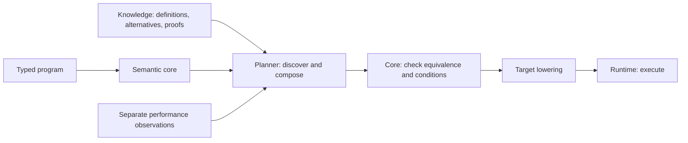

# Ink

**A programming language whose optimisation knowledge can grow independently of its compiler.**

Write typed programs that describe computation, state and permitted changes. An
external knowledge store supplies alternative implementations and mathematical
proofs. A planner discovers and combines them; a small semantic core checks that
each accepted change preserves the actual program's meaning.

The ambition is to make better algorithms, storage layouts and execution plans
reusable across programs. Adding a proved law can improve existing code when rebuilt, without
editing its source or adding a dedicated compiler pass. This already works for
supported transformations; broader coverage and consistently competitive
execution remain active engineering work.

Ink is a working prototype with native, JavaScript, WebAssembly and eligible GPU
execution. The [implementation status](STATUS.md) separates available features,
proof coverage and work being integrated. The [full language design](docs/language-specification-draft.md)
also contains proposed features.

[Practical guide](https://siliconjungle.github.io/ink-spec-site/) ·
[Language reference](https://siliconjungle.github.io/ink-spec-site/reference.html) ·
[Design and ambitions](docs/vision.md) · [Benchmark evidence](BENCHMARKS.md)

## Philosophy

**Keep program meaning stable; let implementation knowledge accumulate.**

Describe the required computation and permitted changes. Make better ways to
execute them reusable. Proofs establish which alternatives preserve meaning;
measurements guide which are worthwhile. Keep the semantic core focused on
meaning and checking, while the store grows its repertoire of implementations.
Judge progress by less work and better complete execution on real workloads.

## How it works



Three questions stay separate:

1. **Is the alternative equivalent?** The core checks its evidence against fixed
   semantics and the exact program.
2. **Does it apply here?** Required conditions must be established at the actual
   application site. A typical input or a past observation cannot prove them.
3. **Is it worth choosing?** Cost estimates and comparable measurements guide
   selection. A correct transformation can still run more slowly.

For example, a collection law can replace successive maps with one composed
map. Other laws remove an unobserved traversal, preserve ordered reductions or
eliminate sorting before an order-insensitive observation. The database supplies
the law; the compiler checks its application. Supported stateful candidates can
also define physical layouts, cached queries and migrations, with preservation
obligations for every source action.

[Source-derived point dependencies](docs/key-sensitive-access.md) follow aliases,
helpers and input guards without new syntax. The planner uses them to discover
proved point-cache maintenance candidates, retaining conservative refresh paths
for unsupported accesses and the existing measured profitability gate.

The knowledge store contains immutable, content-addressed JSON files and pinned
snapshots, with a rebuildable SQLite discovery index. Its role goes beyond storing
proof files: it makes typed laws, conditions, dependencies and implementations
discoverable by the optimiser. Storage grants no mathematical authority.
Selections carry the needed evidence and can be rechecked offline without a live
database. See [semantic selection](docs/semantic-optimisation.md),
[stateful representations](docs/database-representations.md) and
[the data contract](docs/repository-architecture.md).

## What runs today

| Area | Implemented scope |
| --- | --- |
| Pure computation | Wrapping words, signed arithmetic, binary32, vectors, records, collections, bounded loops, owned local buffers/maps and [checked recursion/ordered parallel work](docs/bend-inspired.md) |
| Application state | Typed tables, queries, atomic changes, rollback, ordered events, maintained results and portable snapshots |
| Targets | Native C/Rust, JavaScript ES modules, C/Rust WebAssembly and eligible WGSL through WebGPU/wgpu |
| Checked optimisation | Composable expression rewrites, eligible pure action regions and complete action replacements in a documented subset |
| Physical representations | Database-defined layouts, cached-query implementations and checked transaction-boundary migrations; currently a restricted source domain and Rust definition executor |
| Incremental work and selection | Fixed-key query delta maintenance with refresh fallback; external selection that charges checking, setup, calls, memory and migration |
| Deployment | Explicit modules, a small standard library, relocatable installation, diagnostics and durable host adapters |

Execution support is broader than proof-based replacement support. Numerical state,
for example, runs on the CPU targets, while the current physical-representation
proof path excludes floating arithmetic and exact-Int aggregates. GPU execution
covers eligible pure work; transactions run on the host. [Parallel work, owned partitions, GPU scratch storage and checked recursion](docs/bend-inspired.md)
now run under explicit target limits. The optional independent Lean verdict checks
a limited Boolean equality calculus; it does not verify the complete compiler.

The [target parity contract](docs/lowering-parity.md) records exact coverage and
limits. Complete C emission uses a shared Rust primitive runtime. JavaScript keeps
are recomputed. F32 arithmetic uses canonical NaNs and source-order binary32
operations; the packed GPU emitter implements these through integer lanes.

Recent integration adds [215 owned Buffer/Map laws](docs/owned-optimisation.md),
List state/action correspondence and [point-query delta candidates](docs/point-query-delta.md).
The [measured lifecycle profile](reports/incremental-maintenance-selection/README.md)
selects the simpler direct layout on its small fixture; the proved delta candidate
remains available without becoming the default.

## Get started

Build with Git and Rust/Cargo:

```sh
git clone --recurse-submodules https://github.com/siliconjungle/ink-lang.git
cd ink-lang
cargo build --release --locked
printf '[[1, 2, 3], 2]\n' > arguments.json
target/release/ink run examples/hello.ink total arguments.json
# 12
```

The example is ordinary Ink source:

```ink
fn total(xs: List<u64>, scale: u64) -> u64 {
    return sum(xs.map(fn(x) => x * scale));
}
```

Compile it, or enable search over the pinned knowledge snapshot:

```sh
target/release/ink build examples/hello.ink --target javascript -o build/hello.mjs
(cd knowledge && python3 -m ink_knowledge --root . rebuild)
target/release/ink build examples/hello.ink \
  --optimise knowledge/store/snapshot.json -o build/hello
```

Search needs Python; native/Wasm builds use existing target toolchains.
`--selection selection.json` replays supplied evidence without discovery.
Core-only builds need no knowledge, planner, runtime or lowering checkout.

For installation, optional toolchains and inspection, see
[installation and diagnostics](docs/installation.md). `ink doctor` reports tool
availability; `ink explain SOURCE` describes checked types, effects and selections.
[Particles](examples/particles.ink), [local collections](docs/local-collections.md)
and [state/host interfaces](docs/wasm-abi.md) show larger programs.

## Performance and direction

The strongest demonstrated gains come from removing work: fewer traversals,
intermediate collections, redundant observations and GPU dispatches. Recent
database-only batches changed selected code with the production compiler
unchanged. They improved many measured workloads and also produced regressions.
Strong handwritten Rust and JavaScript controls often remain faster.

Current priorities are to carry useful facts through composition into lowering,
reduce allocation and state-transport costs, broaden proof coverage for existing
operations, and choose among checked alternatives using target and workload
evidence. Incremental maintenance should respond to exact changes; profiles can
decide whether maintaining a cache pays for its setup and writes.

The goal is competitive complete execution on specified workloads and hardware.
Construction, copying, proof/search costs, teardown, migration and GPU transfers
all matter. [Benchmarks](BENCHMARKS.md) distinguish those boundaries and retain
adverse results. [The plan](PLAN.md) defines acceptance gates; no example establishes
that Ink is universally fastest.

## Repositories and trust

| Repository | Responsibility |
| --- | --- |
| [ink-lang](https://github.com/siliconjungle/ink-lang), `core/` | Fixed semantics, typed executable representation, reference execution and general evidence checking |
| [ink-lang](https://github.com/siliconjungle/ink-lang), distribution | CLI, exact dependency assembly and integration tests |
| [ink-knowledge](https://github.com/siliconjungle/ink-knowledge) | Canonical definitions, candidates, laws, proofs, snapshots, discovery and separate performance observations |
| [ink-planner](https://github.com/siliconjungle/ink-planner) | Untrusted bounded search, composition, applicability evidence and cost selection |
| [ink-runtime](https://github.com/siliconjungle/ink-runtime) | Execution, scheduling, common decision application, fallback, persistence and delivery |
| [ink-abi](https://github.com/siliconjungle/ink-abi) | Shared value descriptors, transport, layouts and Rust/Wasm execution decisions |
| [ink-native-support](https://github.com/siliconjungle/ink-native-support) | Generated typed/dynamic value primitives, owned collections and state exports |
| [C](https://github.com/siliconjungle/ink-lowering-c), [Rust](https://github.com/siliconjungle/ink-lowering-rust), [Wasm](https://github.com/siliconjungle/ink-lowering-wasm), [JavaScript](https://github.com/siliconjungle/ink-lowering-js), [GPU](https://github.com/siliconjungle/ink-lowering-gpu) | Literal target emission and device operations |

Proof authors and search need not be trusted to choose correct transformations:
the core rechecks supplied evidence. The Rust checker, source correspondence,
codecs, lowering, hosts and toolchains remain trusted implementations. A checked
high-level transformation is not an end-to-end proof of machine code. Lean
research supports specific mathematical claims and does not verify the complete
compiler. The [independent Boolean verdict](docs/bend-inspired.md#independent-boolean-verdict)
proves its separate calculus sound; its translator and source correspondence remain
unverified. Old aggregate certificates, bounded caches, typed storage policies and historical
scalar loaders have been removed. There is no legacy admission feature.

See [current status](STATUS.md), [architecture](docs/repository-architecture.md),
[benchmark methodology](docs/benchmark-methodology.md) and [acceptance gates](PLAN.md).

[Universal optimisation boundaries](docs/universal-optimisation.md) describe the
explicit control/owned-buffer primitives, database laws and shared host policy.

[Scalable typed state](docs/scalable-state.md): batch writes, direct table reductions, shared keys, touched-row rollback and locally checked maintenance candidates.
