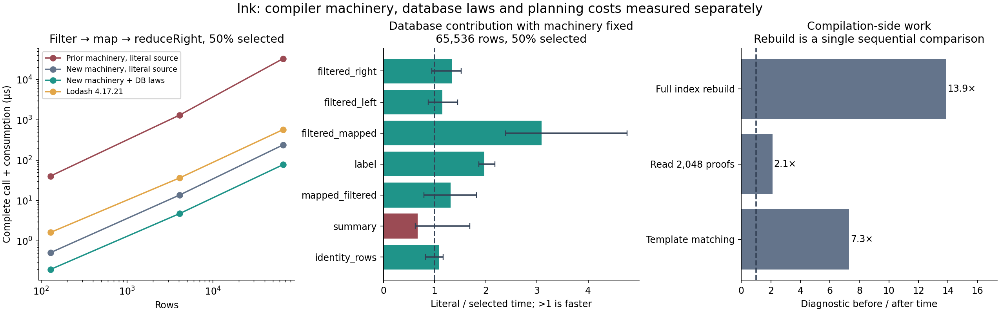

# Broad performance research, October 2026

Ink's best opportunity is to remove complete categories of work: intermediate
collections, conversion of unobserved fields, repeated proof processing, and
searches across irrelevant patterns. A larger collection of specific algebraic
endpoints does not by itself remove those costs.

This pass audits the active catalogue, researches mechanisms across systems,
and implements the immediately useful general ones. The evidence distinguishes
new compiler capabilities, database growth, discovery cost and complete execution.
The new benchmark is a designed ablation and a pinned Lodash chain comparison;
it is not a new estimate of performance generalisation on unseen applications.

## What the database actually contains

The starting snapshot is
`40a8b18a885b3b2abbc398dc118c551c5ae07f5b946455b4beed515d56f26041`.
Its 26,628 authenticated members include:

| Role | Entries | Interpretation |
| --- | ---: | --- |
| First-order inductive theorems | 19,000 | Mathematical dependencies, not 19,000 distinct deployable optimisations |
| First-order definitions | 3,122 | Datatypes, algorithms, observations and proof vocabulary |
| Executable semantic rewrite laws | 3,733 | Typed equations with replayable proofs |
| Source representations | 94 | Source-bound implementation and observation correspondence |
| Representation migrations | 37 | Checked transitions between representations |
| Implementation candidates | 22 | Composed candidate packages |
| Type-parametric semantic templates | 14 | Authoring data instantiated and checked for the encountered types |
| Source algorithm templates | 4 | Ordinary helper code/types plus a separately checked rewrite proof |
| Target work measurements | 576 | Cost evidence; no mathematical authority |

The audit examines every active semantic rewrite. 2,138 have callback parameters;
141 carry explicit definition contexts; 51 have conditions. The remaining laws
are not automatically broad: concrete carrier sorts and expression shapes still
limit applicability. Their canonical entry bytes total 15,083,586 bytes. These
counts measure roles and interfaces, not semantic uniqueness or profitable coverage.
The active proof index also holds 435,513 dependency edges. Its size and preparation
cost matter even when only a handful of rules apply to a program.

The catalogue already covers pipeline fusion, slices, ordered reductions, loops,
collection edits, incremental aggregates/joins, maintained views, structural sharing,
compact storage, bounds, unchanged fields, allocation capacities and routing.
The earlier search experiment reached more checked alternatives but generated
almost identical selected code. That is evidence for better discovery, not a
broad runtime speedup; see [the earlier measurements](search-planning-evidence.json).

## What is compiler machinery, and what is expressible data?

| Layer | Current mechanisms | What another database entry can supply |
| --- | --- | --- |
| Language/core | Typed elaboration, lexical binding, contracts, primitive meanings, effects, ownership, recursion and resource limits | Source algorithms assembled from the admitted operations; new private helper functions, records and nominal declarations through checked extensions |
| Proof bridge | Typed semantic terms, beta computation, induction/generalised induction, cases, quantified assumptions, exact word/Int reasoning, source/representation correspondence | New equalities, conditional transformations, invariants, codec proofs and algorithm implementations |
| Planner/knowledge tooling | Typed matching, head reachability, memo search, bounded caches, streamed recipes, checked sessions, offline measurement and selection | New patterns, templates, composed plans, physical choices and measured/fitted cost data |
| Literal backends/runtime | Collection/loop emission, moves and borrowing, scoped buffers, columns, packed lanes, shared nodes, dispatch/residency, ABI conversion | Selection and composition of capabilities a target actually supports |

Current executable types are `u32`, `i32`, `u64`, `f32`, `Int`, `Bool`, `String`,
`Unit`, vectors, `List`, `Buffer`, local `Map`, `Option`, `Result`, transactional
`Table`, and declared nominal types: records, enums/payload enums and IDs.
Generics and source control flow elaborate to checked executable forms. `Unknown`
is an internal inference marker, not an application value type.

Source, pure proof admission and target coverage remain different sets. Strings
are useful value carriers, but the pure bridge does not model a full text-splice,
Unicode indexing or rope algebra. Arbitrary JSON remains outside this work.
First-order definitions express richer recursive mathematical structures, but a
source-bound representation and supported lowering are required to execute them.
Packed first-order storage currently supports constructor spines; it is not an
arbitrary tree arena. Flat scalar columns and several physical plans currently
execute on Rust/Rust-Wasm, with explicit rejection on other targets.

The database can introduce algorithms and representations built from admitted
operations. Giving an entirely new machine operation its meaning, ownership and
backend implementation still requires trusted machinery. The useful aim is a
small set of general mechanisms that unlock many database descriptions.

## Research and decisions

These are primary documentation or research papers. The Ink applications below
are our engineering conclusions, not claims that these sources evaluated Ink.

| Source | Mechanism worth borrowing | Decision for Ink |
| --- | --- | --- |
| [Git commit graphs](https://git-scm.com/docs/commit-graph-format.html) | Separate compact graph metadata from object bodies; changed-path Bloom filters narrow graph walks | Keep proof authority in canonical objects, while disposable summaries cheaply narrow discovery. Existing Merkle snapshots already supply identity; Bloom filters are a possible later accelerator, not a substitute for checking. |
| [Git pack format](https://git-scm.com/docs/gitformat-pack) | Indexed and compressed immutable objects | A packed catalogue could reduce installation and cold I/O. Defer until reader/transport/version contracts and partial-access costs are measured; do not add another authoritative format. |
| [SQLite foreign keys](https://www.sqlite.org/foreignkeys.html) | Index the child side of references to avoid repeated linear scans | Implement reverse dependency and membership indexes. This removes a measured preparation bottleneck without disabling constraints. |
| [SQLite query planning](https://www.sqlite.org/queryplanner.html) | Index predicates and ordering; use covering indexes where worthwhile | Inspect actual query plans before adding indexes. Warm typed-head queries already use a covering index; cold dependency insertion was the more important gap. |
| [Cascades research](https://www.srdc.com.tr/share/publications/1995/cas.pdf) | Demand-driven group exploration, physical properties and constrained search | Ink already has exact-state memo search. Next consider grouping equivalent subexpressions and retaining alternatives by physical requirements, with proof edges preserved. A wholesale planner replacement is not justified by this pass. |
| [Relational E-Matching](https://arxiv.org/abs/2108.02290) | Treat matching as indexed joins over pattern structure | Index template sites by operation head and retain full type/binder matching. Consider deeper relational indexes if profiling shows the remaining candidate buckets dominate. |
| [MLIR pattern rewriting](https://mlir.llvm.org/docs/PatternRewriter/) | Root-operation indexing, worklists and separation of patterns from drivers | Implement a shared structural site index for database templates. Existing executable matching already indexes heads and caches subtrees. A changed-node worklist is a future step, requiring careful scope and proof-path tracking. |
| [Stream fusion](https://arxiv.org/abs/1612.06668) | Stage pipelines into loops that avoid intermediate materialisation | Add 11 carrier-parametric pipeline law families as database data. Preserve ordered reducers and explicitly bind shared mapped values; do not assume float associativity. |
| [HyPer compilation](https://vldb.org/pvldb/vol4/p539-neumann.pdf) | Keep data in a compiled pipeline rather than materialising between operators | Address the whole boundary as well as the inner loop. New lexical field demand lets JS avoid converting fields that the checked computation cannot observe. |
| [Compiled versus vectorised execution](https://www.vldb.org/pvldb/vol11/p2209-kersten.pdf) | Both execution models can perform well; layout and algorithms also matter | Do not assume a compiler or GPU is automatically faster. Keep full-call measurements, conversion costs, selective workloads and regressions visible. |
| [rust-analyzer architecture](https://rust-analyzer.github.io/book/contributing/architecture.html) | Separate parsing from tree representation and query-based analysis | Keep syntax/IR/storage boundaries distinct. Immutable summaries and dependency-aware reuse are more relevant immediately than rewriting the parser. |
| [Rust incremental compilation](https://rustc-dev-guide.rust-lang.org/queries/incremental-compilation-in-detail.html) | Red-green dependencies and stable query identities | Future compilation caching should bind exact source, declarations, compiler, backend and catalogue inputs. Reuse is a discovery/execution shortcut; independent admission still needs a sound replay boundary. |
| [Tree-sitter](https://tree-sitter.github.io/tree-sitter/using-parsers/3-advanced-parsing.html) | Cheap shared trees and incremental reparsing | Useful for the browser editor and repeated compilation. Defer parser replacement until parsing is a measured bottleneck; it would not fix the conversion and database costs found here. |
| [Nominal Adapton](https://arxiv.org/abs/1503.07792) | Stable names for reusable subcomputations across changes | Promising for view maintenance and tree summaries. Names must identify computation inputs, not grant equality or justify retaining mutable host objects across calls. |
| [RRB trees](https://rtheunissen.github.io/bst/docs/references/2012_bagwell_rompf.pdf) | Persistent concatenation/splitting without whole-vector copying | A worthwhile database representation experiment. Need universal ordered decode/update proofs and supported multi-branch storage. Current packed spines alone do not supply RRB node layout or balancing. |
| [Arrow format](https://arrow.apache.org/docs/format/Columnar.html) | Column locality, dictionary and run-end encodings, explicit layout tradeoffs | Extend checked codecs/layout descriptions rather than hard-code application storage. Prioritise partial observation and conversion boundaries before adding every encoding. |
| [egg](https://arxiv.org/abs/2004.03082), [egglog](https://arxiv.org/abs/2304.04332) | Congruence sharing and incremental relational analyses | Useful next experiments for proof-producing search. An e-class identity must never become a proof premise; extraction must retain a replayable derivation and account for operational sharing. |

## Implemented mechanisms

**Database:** 11 new parametric families: map composition, filter composition,
ordered filter-fold for both directions, ordered concat-fold for both directions,
filter/map/right-fold, map/filter/right-fold, count-after-map, length-after-map,
and identity map. Rows, mapped values and accumulators need not have the same type.
The generic instantiator creates ordinary proof objects and binds nominal contexts.
Templates are authoring data; every concrete selected instance is checked.
The published snapshot grows to 26,639 entries and 25 parametric templates,
with all prior objects and snapshots retained.

**Core:** curried known-callback reification now carries application through value
bindings. Arguments retain left-to-right evaluation and run once; no dynamic
function hole becomes executable. Conservative lexical input demand follows row
fields through aliases, known collection callbacks, slices, concatenation and zip.
Whole-value observations, escaping rows, unknown calls, unusual depth and accumulator
escapes retain full conversion. This is fixed binding/dataflow machinery, not an
algorithm matcher or a new mathematical rewrite authority.

**JavaScript:** pure entrypoints use the actual checked body's field demand for
private input conversion descriptors. Public logical metadata is unchanged;
state input validation stays complete. Contract preconditions retain full input
conversion. Schema memoisation now owns one weak cache per schema per invocation,
and record copying avoids temporary entry arrays while preserving `__proto__` as
an ordinary own data property. The trusted pure value ABI does not specify host
getter side effects or callback invocation traces as Ink observations.

**Knowledge tooling:** object loading validates/canonicalises once, then uses those
same bytes for size limits and hashes. It re-reads on later exports. Template
matching traverses each subject once and narrows by operation head before full
inference, sharing the mechanism with source-algorithm discovery. The template
catalogue limit rises from 128 to 4,096; node and inference budgets remain explicit.
Reverse SQLite indexes preserve foreign-key checks and migrate atomically.

## Evidence and interpretation

The machine-readable report and chart accompany this document. The benchmark
includes complete trusted JS calls, generated representation conversion, full
result consumption, immutable input checks, 11 interleaved rounds, three sizes
and three selectivities. It compares the same pipeline with and without checked
DB transformations, old/new conversion machinery, and the actual published
Lodash 4.17.21 chain on an exact positive-word sum domain. Other workloads are
pipeline kernels, not full creative applications or a product ranking.

The first ablation showed almost no runtime benefit from the new laws because
record conversion dominated. Faster schema caches helped, but still copied every
row. Lexical field demand then removed conversion of an unrelated float field
from score-only computations. Database transformations and execution machinery
therefore need separate curves: either can expose or hide the other's value.

Proof loading of 2,048 actual entries improved from a warm median 3.38 s to
1.60 s (2.1×; four sequential samples). Full index rebuilding with single-pass
loading but missing reverse indexes took 614.57 s; adding the indexes took
44.31 s for the same 26,628 members (13.9×). The latter is a sequential diagnostic,
not a repeated confidence interval. The rebuilt cache grows from 512.9 MB to
587.6 MB; speed and extra index storage are separate outcomes.

Correctness evidence includes 99 reference requests across C/Rust/JS/both Wasm
paths and the wgpu host, with six actual eligible GPU calls, exact values and
snapshots; curried capture/once-only bindings; input demand escapes/shadowing;
conversion aliasing, schema separation, later-call mutation, raw floats and
special property names; and false source applications. Existing representation
and transaction checks remain required. The representation-only CI shard's Lean
preflight is corrected to require Lean when its selected suites actually use it;
general/all shards still require the independent lifecycle checker.

The historical knowledge test discovery is not green: 340 tests produced 71
errors for absent archived fixtures/toolchains and two historical
snapshot/search assertions, with 123 skips. Current scoped unit/admission and
cross-target tests are reported separately; this pass does not represent those
archive tests as passing or treat their skips as performance evidence. The two
assertions were not isolated against a complete baseline checkout, so this is
not a claim that every historical failure is unrelated to the changes.

### Complete-call results

For the pinned Lodash chain at 65,536 rows:

| Retained rows | New literal Ink (µs) | New Ink + checked laws (µs) | Lodash (µs) | DB-only gain | Lodash / selected Ink |
| --- | ---: | ---: | ---: | ---: | ---: |
| About 3% | 71.03 | 61.86 | 404.78 | 1.15× | 6.54× |
| About 50% | 240.19 | 77.72 | 574.40 | 3.09× | 7.39× |
| About 97% | 416.19 | 89.78 | 806.72 | 4.64× | 8.98× |

The prior converter made the same calls take roughly 31–33 milliseconds.
Most of that improvement comes from field demand, rather than the extra laws.
Counting mapped values can become constant-time after a proved rewrite; ratios
on such tiny selected calls reflect call overhead and changed complexity and
should not be extrapolated to an entire application.

The 65,536-row/50% floating summary has a DB-only ratio of 0.67×: the selected
conformance variant is slower. The report includes paired bootstrap intervals
and all observed regressions. An explicit conformance selection tests capability;
only the ordinary planner's offline measured selection decides deployment.
Its independently evaluated filter/map/reduce choice uses separate data from
selection and matches a literal-loop oracle and the pinned package.

The new 11-template conformance subject uses 57 full inference attempts instead
of 2,035 exhaustive template/site pairs, with identical matches. This measures
matching, not complete compilation or a larger-library performance law.
Source-algorithm discovery shares this index; proof checking stays independent.
The reproducible ordinary-planner run records 3.63 s for complete compilation,
including offline acquisition and emission, on its small isolated catalogue.
That is separate from the full-catalogue cold rebuild cost above.

Raw observations, hashes, diagnostic protocols and intervals are in
[the evidence directory](evidence/broad-performance/summary.json).
Reproduction scripts are in `bench/broad-pipelines`; the package integrity is
recorded and the benchmark accepts a verified Lodash 4.17.21 source path.

## Next experiments worth doing

1. **Property-aware memo groups and changed-node worklists.** Measure equivalent
   subtree sharing and avoid revisiting unaffected sites; retain proof edges,
   binder scope and deterministic budget accounting.
2. **Broader observation-driven layouts.** Extend source-bound projection/codec
   facts to nested values, interprocedural demands and additional CPU/GPU targets.
   Current field demand is conservative and shallow; unknown calls can still
   force full conversion.
3. **Persistent balanced sequences and trees.** Implement RRB/chunked-tree
   algorithms as data; add only generic multi-branch storage support if required,
   then benchmark edit/split/concat and traversal with complete output boundaries.
4. **Reusable measured coverage.** Freeze these mechanisms, grow parametric laws,
   and evaluate separately chosen real package/application kernels and distributions.
   Track applicable profitable coverage and compiler cost, not entry count alone.

Ropes need a precise string/byte observation model before they can become sound
text optimisations. Dictionary/run-end layouts need codec and mutation evidence.
Full parser incrementality and equality saturation remain research candidates,
not features claimed by this implementation.
