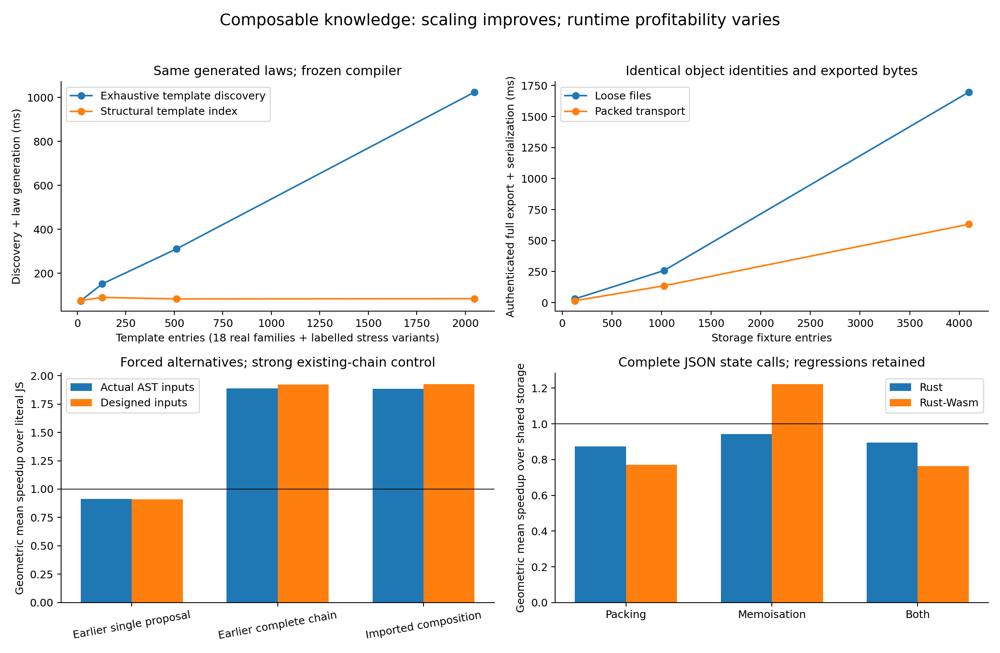

# Composable implementation knowledge

Ink now supports reusable algorithm imports, structural template discovery,
independent physical choices, packed canonical-object transport and exact
optimisation-family attribution. Canonical publication grows from 26,646 to
26,648 objects: one imported algorithm composition and one physical-planning
recipe. Timing observations remain separate from mathematical knowledge.

## Algorithms can reuse algorithms

An `ink-source-algorithm-v1` template may contain an `imports` map. Each import
names a snapshot-owned algorithm, supplies structural type arguments, explicitly
exports helper/type names and supplies an equality-proof label. The parent can
use those helpers and compose their proofs. Shared imports reuse the same
deterministic definitions. Every concrete helper, type, source endpoint and proof
dependency still passes normal compiler admission.

The new catalogue composition transforms:

```ink
count(xs.take(n).concat(xs.drop(n)).filter(fn(x) => x >= cut))
```

into the existing direct filtered-count helper. It imports the partition and
filtered-count families rather than duplicating their helper bodies or induction
proofs. The older complete route takes four extension/rewrite stages; the imported
composition takes two. The compiler does not recognise this expression or the
algorithm's name.

Imports are bounded, snapshot authenticated, cycle checked, hygienically named
and type instantiated. Unknown exports, conflicting definitions, unbound proof
labels and false parent proofs decline or fail checking. Type templates and
discovery metadata are authoring data; they are not trusted theorem schemas.

## Physical choices compose

`definitions: "selected"` permits independently checked `packed_datatypes` and
`memo_functions` sites in one physical plan. The existing exclusive choices
continue to check their original contracts. Every selected datatype must satisfy
the packed-carrier ABI; every memo site must satisfy the immutable-key ABI.
Inventing an ID or changing a strategy tag cannot bypass those checks.

The knowledge recipe now describes structural eligibility with a bounded data
selector language, target domains and independent site choices. Generic proposal
code evaluates those descriptions and interleaves individual and combined choices
within a budget. A large domain cannot consume the budget before other
capabilities get a turn. Backend constraints remain compiler checks, while
proposal construction and combinations belong to knowledge.

Rust and Rust-Wasm lower selected sites literally. The native snapshot bridge now
also handles packed multi-field key/value cells through their normal packed cell
interface. The experiment exposed the earlier bridge's enum-pattern assumption;
the corrected bridge preserves full-word values, order and portable snapshots.

This is a vocabulary of existing checked capabilities, not arbitrary machine-code
extensions. New layouts or allocation mechanisms still need fixed semantics and
backend implementations. Templates can define new derived algorithms using those
operations without another compiler recogniser.

## Storage and discovery

Canonical objects, dependency hashes and immutable snapshots retain their formats
and authority. SQLite remains a rebuildable discovery projection. New tables index
template operation heads and bounded structural paths, and relate observations to
the family IDs explicitly recorded by their authors.

Structural filtering requires one source site satisfying a template's necessary
tokens. It does not combine evidence from unrelated sites. Holes and higher-order
abstractions are handled conservatively. Remaining candidates undergo complete
type/binder matching; selected proof closures replay independently. Historical
pins without the index retain exhaustive discovery. Applicable templates fetch
their authenticated proof dependencies even when those dependencies are not
independently applicable.

`python -m ink_knowledge --root KNOWLEDGE pack` atomically produces optional
`store/objects.pack.sqlite`. Pack-only distributions can omit loose object files;
this command does not delete canonical Git files. Each retrieved object still
passes canonical validation and content hashing. Membership witnesses and proofs
are unchanged. Loose objects take precedence, so a corrupt existing file cannot
be hidden by its valid packed copy. Failed pack publication preserves the prior
pack. A bundle uses one pack read transaction.

`ink_knowledge.family_evidence.page` retrieves explicitly attributed observations
for exact target and workload descriptors. It authenticates observation bytes and
checks their recorded family IDs after indexed discovery. Missing attribution
remains unknown. Performance observations never discharge a mathematical premise
or automatically install a selection model.

## Evidence and limits



The frozen-compiler experiment and raw samples are in
[evidence/composable-knowledge](evidence/composable-knowledge/summary.json).
Reproduction and timing boundaries are in
[the benchmark README](../bench/composable-knowledge/README.md).

Structural discovery grows much more slowly than exhaustive template loading in
the measured stress catalogue, while producing exactly the same laws. The stress
entries are labelled identity-map variants, not new optimisation families; all
2,030 concrete Bool instances pass independent checking. Packed transport improves
authenticated full export on the measured storage fixtures. Index setup and pack
size costs are retained separately.

The imported composition improves the chosen sequence kernel relative to literal
JavaScript, including actual Acorn/Lodash AST positions as inputs. Its performance
is comparable to the older complete transformation chain. It demonstrates reusable
proof construction and fewer planning stages, not a new runtime breakthrough.
The older single-step alternative and every adverse cell remain in the report.

Independent physical choices are deliberately forced for capability measurement.
Packing and combining packing with memoisation regress the state-query cohort;
memoisation helps the measured Rust-Wasm cohort but does not uniformly help native
Rust. Construction and insertion are measured separately. Missing comparable
profitability evidence still retains the baseline.

The source programs were chosen to exercise these capabilities. Real input data
does not make them an unseen-source generalisation test. The charts do not establish
an accelerating database-performance growth law. They measure search scalability,
transport cost and particular executable alternatives under explicit boundaries.
