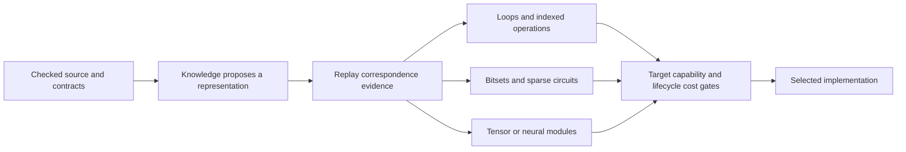

# Contract-guided circuits and differentiable computation

Status: research design, prompted by James's review of Handwired on 15 October
2026. This document proposes an investigation; it does not announce a neural
backend, automatic differentiation or a general JavaScript compiler in Ink.
It extends the physical-representation investigation within the
[full optimisation programme](optimisation-language-programme.md).
The [Handwired integration inventory](handwired-integration.md) tracks the
mechanisms, owning layers, performance gates and work still required.

## Three different capabilities

| Capability | What changes | Required guarantee |
| --- | --- | --- |
| Compile exact code into a circuit | Representation and execution schedule | Source/circuit correspondence, including the numerical domain and observations |
| Place exact code inside a trainable system | The surrounding system and its gradient interface | Exact forward behavior plus a separately specified derivative or estimator policy |
| Learn an alternative implementation | Weights, parameters or algorithm | Ordinary equality, a checked allowed-answer contract, or an explicit approximation relation |

Handwired motivates all three, but their acceptance conditions differ. Its
[execution model](https://github.com/chenglou/handwired/blob/09f23d276d3b9284cea4eec61ffd934950cc979e/docs/execution-model.md)
defines FP32 instructions, explicit rounding points, index reads and caller-supplied
range/grid/one-hot declarations. A false declaration can invalidate an optimization.
Its backward pass differentiates intended real arithmetic; hard decisions need
explicit gradient policies. Circuit execution agreement therefore has a different
scope from preserving arbitrary JavaScript behavior or proving a derivative.

The [source compiler experiment](https://github.com/chenglou/handwired/blob/09f23d276d3b9284cea4eec61ffd934950cc979e/lab/trace-compiler/README.md)
supports a defined bounded numeric subset and reports drift from native float64
JavaScript. The usable lesson is to make the input domain, arithmetic and
observation contract explicit before selecting a representation.

There are relevant precedents. [Tracr](https://github.com/google-deepmind/tracr)
compiles bounded RASP programs into transformer weights without training those
weights. [Enzyme](https://enzyme.mit.edu/) differentiates supported programs at
LLVM IR level. [Futhark's flattening work](https://futhark-lang.org/blog/2026-07-31-full-flattening.html)
shows how functional dataflow can expose GPU parallelism, while highlighting
the memory-traffic costs of splitting computation into too many kernels. These
are distinct techniques; Ink should compare the useful mechanisms separately.

## The opportunity for Ink

The common foundation is a program whose meaning survives several internal
representations. Ordinary control flow, relational operators, bitsets, sparse
circuits and tensor operations can each expose different implementation choices.
The compiler can preserve the connected computation while external knowledge
proposes transformations and execution plans.

This is a proposed extension of Ink's existing separation of meaning,
implementation knowledge, checking and profitability. Representation names,
model architectures and a successful sample must confer no authority.

Useful facts include exact bits, one-hot/at-most-one selections, finite ranges,
integer grids, bounded shapes, sparse structure and checked associative
composition. They should come from checked source invariants, ordinary laws or
validated guards with an eligible fallback. Their transport across functions,
queries and representations matters as much as the syntax used to state them.

An exact bit can occupy one lane of a packed word. A valid one-hot weighted
selection can sometimes become one gather. Independent state-machine instances
can execute across records. Associative transition composition can sometimes
replace a sequential dependency chain with a scan. Every such transformation
needs its actual premises: arbitrary FP32 addition does not supply associativity,
and bounds in `[0,1]` do not establish an exact bit.

## Why collection meaning matters here

Some relational computations have useful matrix or bitset formulations. Boolean
relation composition combines alternatives with OR and paths with AND; counting
composition uses addition and multiplication. A named, checked algebra can state
which operations apply. Dense matrices, sparse matrices, indexes and ordinary
tuples then become competing physical representations of the same declared
observation.

The collection contract determines whether that freedom exists. A set-valued
observation can ignore duplicate paths, a bag-valued observation must retain
multiplicity, and a list-valued result also exposes enumeration order. A matrix
representation cannot silently erase those distinctions. Exact multiplicities
also need an exact carrier or checked bounds before fixed-width arithmetic is
admitted. This directly connects circuit research to the programme's Bag/Set
semantics and algebraic interfaces.

Keeping relational, circuit and tensor structure visible could let a future
planner fuse a query-derived feature computation with a model that consumes it,
or retain both on a device. That requires correspondence across the complete
region, including transport and state-observation boundaries. It is a concrete
extension of the application's query/execution boundary, with additional precision
and training contracts when a model is involved.

## Precision, control flow and effects

Ink's words, exact integers and binary32 values retain their own meanings.
Representing a word as one floating value needs a checked representable range;
larger values require multiple lanes or bits. Circuit fusion must preserve
required rounding points, arithmetic NaNs and signed-zero observations, or use
an explicitly admitted weaker numerical contract. Matrix hardware with a
different precision policy needs the same treatment.

Evaluating both sides of a branch requires a preservation argument. Lazy
fallbacks, failures, resource use and nonfinite intermediates can matter even
when a branch's contribution is multiplied by zero. State writes, errors,
ordered events, rollback and transaction visibility require complete action
reasoning. Begin with pure, bounded regions whose contracts can be checked.

Fixed circuits also have costs: padding, inactive branches, unrolling, graph
construction, shader/model compilation, retained weights, work depth and transfers.
A dense matrix expansion may multiply work even when it shortens a dependency
chain. Scalar, SIMD, indexed, sparse and GPU alternatives must remain available
for lifecycle comparison.

## Differentiation needs its own contract

An exact discrete function can have an unhelpful or undefined derivative. Exact
forward evaluation, differentiability of a real-valued model, and a useful
training signal are separate properties. A forward-preserving straight-through
estimator is an explicitly chosen gradient estimator.

A future differentiation interface should identify the primal computation,
active parameters, mathematical lifting/rounding policy and treatment of
boundaries. Derivative claims need separate obligations. Finite-difference and
differential tests provide implementation evidence within their tested domain.

This could enable inverse design, simulations, geometry and constrained learning:
a known algorithm supplies part of a larger trainable system, while selected
parameters change. The final parameters still need to satisfy the application's
checked contract. Training arbitrary weights changes the function and does not
inherit the original program's correctness evidence.

Learned proposal ranking can also improve compiler search while exact output
semantics remain fixed. A learned surrogate that intentionally changes outputs
instead needs an allowed-answer or approximation contract, including its domain,
error relation and any probability scope. Reusable approximation laws are a
foundation; broad statistical certification remains work.

## Experiments and acceptance gates

1. **Matched automata and literal search.** Retain exact generated documents,
   independent complete per-document counts, native/JS/Wasm controls and real
   GPU dispatch. Measure resident and transfer-inclusive execution, setup, memory
   and small/adverse workloads. Separate literal specialization from general regex.
2. **Certified bits and one-hot selection.** Derive the facts from source, replay
   pack/unpack and selection correspondence, and reject forged facts. Include
   false fractional bits, multiple active choices and nonfinite candidates.
3. **Sparse circuit versus ordinary code.** Compare equivalent bounded kernels
   with the same arithmetic and output boundary. Retain unfavorable branching,
   sparsity, padding and dependency-depth cases.
4. **A smooth differentiable kernel.** Specify forward and derivative semantics;
   independently validate both. Compare code-level AD with an expanded neural
   representation rather than assuming a neural carrier is required for gradients.
5. **A frozen algorithm inside a learned system.** Demonstrate what is trainable,
   the source contract after training and the cost of crossing execution systems.

The first matched search investigation is in progress. Its measurements must
remain separate from claims about general neural compilation, complete JSON
parsing/highlighting, or automatic query optimization. Tests of a concrete
implementation do not close the trusted compiler, ABI, runtime or driver chain.

Accept an internal representation when it exposes reusable, checked choices that
improve measured workloads or enables a demonstrated new capability. Keep the
source interface centered on meaning and contracts; introduce user-facing
neural/tensor syntax only when a concrete interface needs it.
