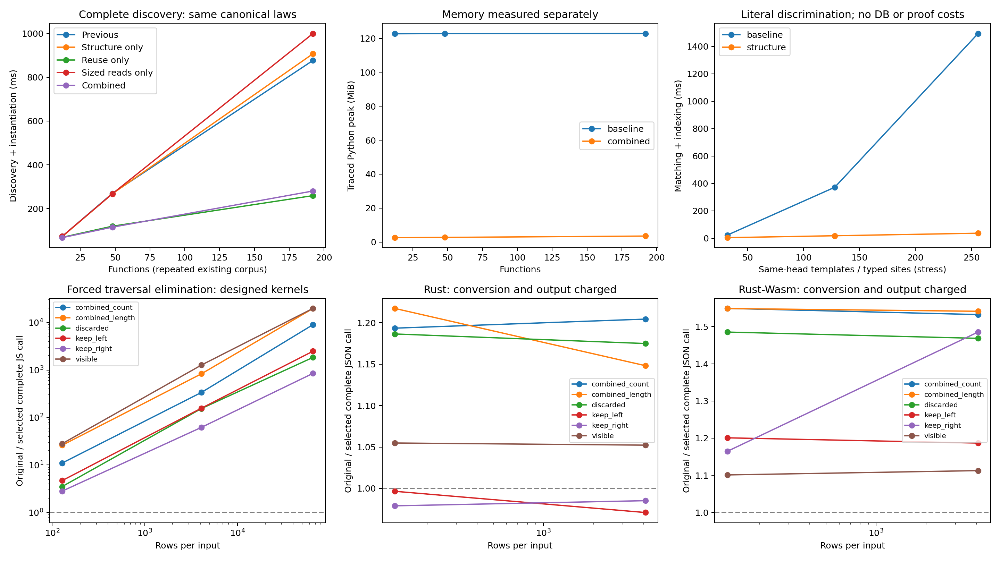

# Cheaper discovery and fewer traversals

This change adds six reusable proof families and improves the knowledge package's
discovery machinery. The core compiler, proof rules, planner, ABI, runtime and
backends retain their previous implementations. The catalogue grows from 26,648
to 26,654 canonical objects. The proof additions and authoring improvements are
measured separately.

## New knowledge

The new `ink-semantic-law-template-v1` entries prove:

```ink
xs.filter(fn(x) => true)                 == xs
xs.filter(fn(x) => false)                == []
foldl(xs, seed, fn(x) => fn(acc) => acc)  == seed
foldr(xs, seed, fn(x) => fn(acc) => acc)  == seed
length(xs.concat(ys))                    == length(xs) + length(ys)
count(xs.concat(ys))                     == count(xs) + count(ys)
```

These equations quantify over item types; the folds also quantify over accumulator
types. Cardinality additions keep the original wrapping U32/U64 meaning. The
proofs use existing induction and normalization. They introduce no special
algorithm names into the checker or lowerers. Eighteen concrete instances replay
for different carriers, including strings, nested lists and floating-point seeds.
The execution fixture additionally instantiates a record containing a string.
Changing the false-filter result and rehashing its object still fails admission.

The algorithms are simple. Their value is expressing the entire family once and
letting the existing system instantiate it for ordinary types. They are designed
applicability examples, not evidence that an independently held-out application
will automatically get faster.

## Reuse during discovery

Previously, catalogue filtering and law matching traversed the same subject
separately. Repeated matching sites then recreated the same type-instantiated
proof dependencies and source-bound higher-order adapters before canonical hashes
deduplicated the final objects.

One invocation now shares its bounded source-site traversal and caches concrete
proof instances by template and exact type bindings. Exact adapters additionally
include their source endpoint. The cache stays inside one source/definition
context; it is never an admission cache. Cached dependency heights preserve the
depth limit, including when a deepest parent is visited after its dependencies.
Generated laws and their full mathematical closures still replay independently.

Larger operation-head buckets use necessary structural paths, exact literals and
concrete sorts. Candidate postings are intersected from the smallest set first.
The resulting sites retain source traversal order. Higher-order applied holes can
absorb arbitrary bodies, so constraints stop at them. Composite constructors are
not mistaken for literal leaves containing their own parameter holes. Buckets
with fewer than 32 sites match directly. Bounds cover source nodes, inference
attempts and indexed tokens.

This direction is consistent with established theorem search techniques.
[Z3's guide](https://microsoft.github.io/z3guide/docs/logic/Quantifiers/) describes
term indexing as a way to reduce pattern-instantiation overhead, and also explains
how overly restrictive patterns can lose useful instantiations.
[Lean's discrimination-tree API](https://lean-lang.org/doc/api/Lean/Meta/DiscrTree/Main.html)
provides another concrete example of structural theorem lookup. Ink's index is a
conservative prefilter for its existing matching rules; it does not add matching
modulo newly asserted equalities.

## Bounded file allocations

The memory experiment exposed a separate issue: each loose canonical read requested
`MAX_VIEW_BYTES + 2`, roughly 128 MB, even for a tiny object. The traced peak was
therefore dominated by a temporary ceiling-sized allocation.

Reads now allocate from the opened descriptor's actual size. The byte ceiling is
checked before reading, and a sentinel read rejects unexpected growth. Stable
canonical objects retain their content hashes, authentication and byte limits.
Pack-only reads and corruption rejection keep their existing contracts. Tests
cover an exact size boundary with a trailing newline, oversized files, growth
and the tiny-object allocation bound.

The memory chart reports traced Python allocations, not resident process memory.
A large requested buffer does not mean all its pages were physically resident.

## Measurements



Raw samples, fixed-cell bootstrap intervals, compiler/producer fingerprints and
regressions are in [the evidence directory](evidence/discovery-reuse/summary.json).
[The benchmark instructions](../bench/discovery-reuse/README.md) describe timing
boundaries and controls.

| Measurement | Result |
| --- | --- |
| Complete discovery, 12 functions | 1.09× faster |
| Complete discovery, 48 functions | 2.34× faster |
| Complete discovery, 192 functions | 3.13× faster |
| Same-head matching, 256 patterns/sites | 40.64× faster; 65,536 → 256 inferences |
| Traced peak at 192 functions | 128.8 MB → 3.69 MB |
| Rust complete JSON counting calls | 1.20× faster |
| Rust-Wasm complete JSON counting calls | 1.54× faster |

Trusted-JS geometric-mean ratios over the three nonempty sizes range from about
53× to 893× across these deliberately eliminable kernels. They are much larger
than the JSON-boundary gains and do not represent typical application speedups.
The Rust unchanged-accumulator folds are about 0.98×: small regressions are retained.
Structural matching alone is about 0.97× on the large generic corpus, while
its discriminating stress workload improves strongly. Descriptor-sized reads
remove the large temporary allocation; their isolated timing lane is about
0.88× at 192 functions. These ablations are why the report separates mechanisms.


Discovery uses the existing 12-function typed corpus, then repeats its functions
four and sixteen times. All ablation lanes produce byte-identical canonical laws;
all 25 unique generated laws replay through the unchanged kernel. Repeating
functions measures reuse and module growth, not unseen-program generalisation.

The same-head matching curve is a separate stress experiment: valid identity-map
patterns with different literal equality/choose bodies. Each pattern matches
exactly one site. Its timer includes index construction and matching, and excludes
database reads, proof generation and checking. The variants are not counted as
new optimization families.

Runtime samples force the new checked plan on six designed kernels. Trusted JS
calls consume their results and verify values and unchanged inputs. Native Rust
and Rust-Wasm additionally charge JSON validation, conversion and full output
serialization. Inputs are constructed outside call timing; native/Wasm setup is
recorded separately. These contracts differ, so the report compares original and
selected code within each backend. Large JS ratios reflect removing entire
traversals or temporary lists; conversion-heavy contracts retain substantial work.

There is no new automatic profitability policy. The entries enter ordinary
proof discovery, but these runtime timings establish forced applicability and
performance, not automatic default selection. Empty cases and regressions remain
in the raw report. Interleaved samples run on a shared developer machine; intervals
express fixed-cell sample variability, not confidence over an unseen-program
population.

## Next targets

The results suggest four useful follow-ups:

1. Extend the disposable catalogue projection with necessary literal/sort
   constraints, so same-head misses can be rejected before opening proof objects.
   Old indexes must retain complete discovery, and a new projection needs a
   versioned migration and byte-identical-output controls.
2. Reuse unaffected discovery work after a planning rewrite. Invalidation must
   account for helper definitions, nominal declarations and lexical context,
   while admission still checks each selected proof closure.
3. Measure representation and ownership choices on workloads where conversion,
   allocation and output materialization dominate. The Rust no-op folds show why
   a strong algebraic simplification may barely affect a complete host call.
4. Feed source-bound, comparable measurements into profitability selection.
   Separate applicability from selection and retain the strongest existing
   implementation control. This is the route from a useful forced proof to an
   ordinary program improving automatically.

The committed conformance runs cover reference, C, Rust, JavaScript and both Wasm
values, strings, empty inputs and maximum-width integers. After the discovery
change, imported algorithms also pass 28 complete results and exact snapshots,
including 24 actual GPU calls. Sixty-three focused knowledge tests pass. CI now
includes the new proof/discovery tests and the distribution conformance fixture.
