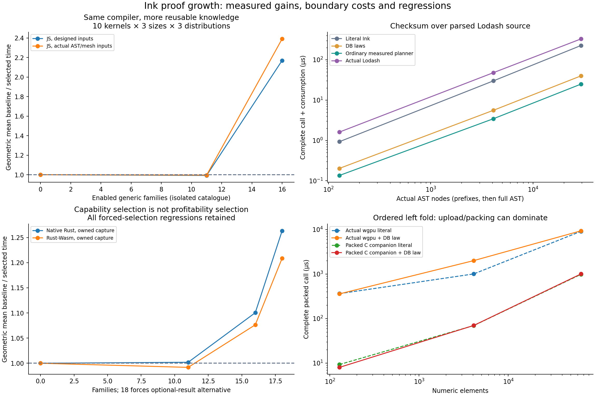

# Proof growth: compiler epoch 3

This experiment adds seven reusable law families, fixes the general machinery
that prevented them from reaching ordinary source, and measures database growth
with each compiler held fixed. The canonical database grows from 26,639 to
26,646 entries. Useful generic pipeline families grow from 11 to 18; 144 concrete
instances pass the kernel across different scalar and composite carriers.

The decisive distinction is between expressing a correct alternative and making
it profitable. The evidence includes both, with the compiler contribution and
forced-selection regressions kept visible.

## What changed

* Type-parametric laws now cover both map-fold directions, left-fold filter/map
  and map/filter fusion, direct first replacement, and an optional-result
  implementation composed with an absorbing-state lemma. Reducers retain their
  original order. No associativity or floating-point reassociation is assumed.
* Bounded higher-order pattern abstraction recognises predicates and mappers
  written directly inside lambdas. It emits ordinary exact-endpoint adapter
  proofs; the checker still requires exact source matches and independently
  replays every dependency. Rehashed false adapters are rejected.
* A typed lexical visitor exposes fixed fold and map callback scopes to checked
  physical planning. The database's borrowing proposals now use those scopes.
* Input demand follows checked helpers and early folds. JavaScript still exports
  the complete logical schema, but unused fields need not be converted. Escapes,
  whole-value observations, unknown operations, contracts and exhausted analysis
  budgets retain complete conversion.
* Rust lowers field reads without copying their containing records, computes
  final-use facts within flattened callbacks, borrows read-only stop observations,
  and defers immutable lexical argument copies when safe. Final-use arguments
  move directly. Owned handles and bodies that may move the root remain on the
  original path. Clone counters check field reads, escapes, captures and moves.
* Packed/scalar C and scalar/graph WGSL now support the existing forward ordered
  fold primitive. It previously ran on the full CPU paths but failed eligibility
  through the packed GPU companion. This adds execution coverage, not a new law.
* Typed empty optional values retain their carried type during reification. The
  optional-result algorithm uses existing language operations and is supplied by
  the database rather than a new executor primitive.

## Protocol and scope

The catalogue checkpoints are isolated subsets of genuine generic template
objects. They do not replay every entry in the full historical database. The
same template/discovery machinery is used at each checkpoint. This isolates
reusable-law growth from source-specific producers and catalogue volume.

Ten kernels exercise helpers, filtered/ordered reductions, checksums, string and
float lookups, Boolean search, drawing-layer transforms and particle bounds.
These source programs were deliberately chosen to exercise the new capabilities;
they are **not an unseen-source generalisation estimate**. Synthetic inputs vary
size and match location, including late and absent matches. Additional input
cohorts use the actual 29,507-node AST obtained by parsing Lodash 4.17.21 with
Acorn 8.15.0 and 14,556 binary32 positions from Khronos's Damaged Helmet model.
Parsing, glTF decoding and typed projection happen before timing. These real
input distributions were acquired after the laws were written.

Comparators execute the actual pinned npm Lodash and Three.js implementations.
The restricted domains preserve equivalent results: unsigned reduction steps
wrap explicitly, and geometry coordinates retain their original binary32 values.
No result is presented as a complete drawing-app, parser or rendering-system port.

JS timings charge complete trusted calls, conversions and full result
consumption. Rust and Rust-Wasm charge owned argument capture and full consumption;
input construction and module setup are outside, and the JSON ABI is not timed.
The C/wgpu numeric companion charges complete packed calls. Actual GPU execution
is required; packing, upload, dispatch, wait, readback and decode are included.
The different boundaries are reported separately rather than used to rank targets.

Conformance authoring intentionally exercises alternatives. It does not decide
profitability. A separate ordinary planner experiment measures and chooses
alternatives for three kernels using independent selection inputs; evaluation
includes other sizes and distributions. It is not a promise that every new law
is selected for every target or profitable for every distribution.

Nine or eleven interleaved samples are retained per cell, with paired bootstrap
intervals. JS post-batch memory observations are diagnostic, not exact peak memory
or allocation counts. The optional-result alternative is explicitly forced at
checkpoint 18 for native capability comparison. Neither its point nor the
geometric mean should be interpreted as an automatic deployment policy.

## Findings

The exact measurements and regressions are in
[evidence/proof-growth/summary.json](evidence/proof-growth/summary.json), with raw
samples, artifact hashes, compilation costs and source provenance alongside it.

The frozen-compiler geometric means are:

| Cohort | Earlier 11 families | 16 families | 18-family optional alternative |
| --- | ---: | ---: | ---: |
| JS, designed inputs | 0.99× | **2.17×** | Not forced in this cohort |
| JS, actual AST/mesh inputs | 1.00× | **2.39×** | Not forced in this cohort |
| Native Rust, owned capture | 1.00× | **1.10×** | **1.26×** |
| Rust-Wasm, owned capture | 0.99× | **1.08×** | **1.21×** |

Each ratio compares complete-call median time with the zero-family baseline;
values above one are faster. These are equal-weight means over the 90 chosen
cells, not population estimates for arbitrary software. Individual adverse
cells remain in the raw data and summary. The GPU numeric cohort's geometric
mean is 0.79× for the fused alternative; the packed C companion is 1.04×.

For the full 29,507-node AST checksum, literal JS takes 226.1 µs, the checked DB
alternative 39.9 µs (**5.67×**), and the ordinary measured planner 25.0 µs
(**9.06×** versus literal). The actual Lodash comparator takes 329.4 µs. The
planner can select additional admitted alternatives, so its result is kept
separate from the isolated-template curve.

Database growth improves execution with the compiler held fixed on this
corpus. The earlier native regression was informative: proof-generated callback
applications exposed whole-record copies in the lowerer. Fixing field reads,
callback ownership and argument binding unlocked the reusable laws across more
kernels. The optional-result algorithm then added a distinct implementation using
existing primitives, demonstrating an algorithm supplied by database data.

The limits remain concrete. Some fused word reductions lose vectorisation and
can be slower than materialised loops. Direct early exit can duplicate expensive
predicates and lose on late/absent matches; the optional-result alternative
addresses predicate duplication but has its own overhead. JavaScript float-heavy
kernels still pay eager conversion across all input rows. Native owned argument
capture can dominate. GPU packing/transfers often conceal kernel-level savings.
More knowledge therefore requires target- and workload-specific measured
selection, not a rule that always chooses the most fused representation.

This supports the claim that reusable accumulated knowledge can improve ordinary
program structures after generic compiler gaps are repaired. It does **not**
establish a universal correlation between total database entry count and unseen
software performance. The next experiment should freeze this machinery and
choose a fresh source corpus independently, retaining the same checkpoints,
compile costs, memory diagnostics and adverse cases.

## Reproduction and validation

See [bench/proof-growth/README.md](../bench/proof-growth/README.md). Canonical
publication, every concrete law admission, exact adapter replay, complete
reference/C/Rust/JavaScript/C-Wasm/Rust-Wasm values and snapshots, and actual
eligible GPU executions were checked. The new and original fixture cohorts cover
signed zero, non-finite payloads, wrapping arithmetic, Unicode, empty inputs,
non-associative reducers, multi-step composition and unchanged inputs.

The full archived research-test suite has older missing fixtures/toolchains and
unresolved historical assertions documented in the previous epoch; this report
does not claim it is green. Current relevant package/unit/admission/conformance
checks are recorded in the validation evidence. Backend emission, runtime,
toolchains and drivers remain trusted rather than formally verified by the law
proofs.

The discovery approach follows the restricted pattern idea described in
[Dale Miller's research account](https://www.lix.polytechnique.fr/Labo/Dale.Miller/projects.html).
The real inputs and comparators are documented by
[Acorn](https://github.com/acornjs/acorn),
[Three.js Box2](https://github.com/mrdoob/three.js/blob/r180/src/math/Box2.js), and
[Khronos sample assets](https://github.khronos.org/glTF-Assets/).
