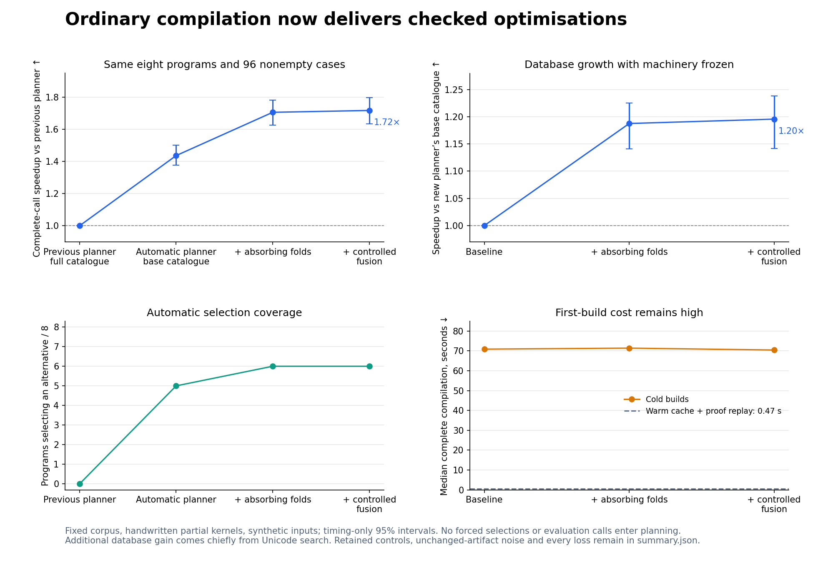

# Automatic optimisation delivery

Ordinary balanced compilation improved complete trusted JavaScript calls by **1.718×** across this fixed eight-program, 96-nonempty-cell corpus. The timing-only bootstrap interval is **1.634–1.797×**. No evaluation calls, supplied workload, manual selection packet or runtime optimisation probe entered compilation.

| Checkpoint | Speedup over previous planner | Automatically selected programs | Median cold compile |
| --- | ---: | ---: | ---: |
| after/base | 1.437× | 5/8 | 70.89 s |
| after/absorption | 1.706× | 6/8 | 71.40 s |
| after/complete | 1.718× | 6/8 | 70.45 s |

With new machinery held fixed, adding six genuine template objects representing two reusable proof schemes improved the same cohort by **1.196×** (1.142–1.238×). Most of that additional benefit came from Unicode equality search, which improved **4.061×** relative to the base catalogue. The controlled-fusion checkpoint does not establish another broad step: most artifacts remain unchanged and its aggregate interval overlaps the absorption checkpoint.

The machinery enabled gains across multiple structures: ordered masked arithmetic **3.94×**, record alert queries **2.01×**, filtered telemetry totals **1.77×**, ordered floating-point energy **1.22×**, and mapped cardinality **1.10×**, versus previous ordinary compilation. The plain projection and row-update controls kept baseline code; their 0.99× measurements are unchanged-artifact timing variation. These are per-program geometric means, not whole application results.

Cold compilation remains expensive: approximately **70 seconds** at the final checkpoint, including search, checking, acquisition and emission. Twenty-four same-epoch repeat builds took a median **0.473 seconds**, replayed the selected full proof, and emitted byte-identical artifacts. Warm caching does not remove the first-build cost or make old measurements universal.

At the intermediate absorption checkpoint, one changed-artifact cell was classified as a regression. At the final checkpoint, the retained run has 39 improved changed-artifact cells, zero changed-artifact cells with intervals wholly below one, and 24 unchanged-artifact cells. This is not a guarantee of no regressions: point estimates, uncertain cases, empty inputs and all raw samples remain in summary.json and timings/.

All 128 cases were checked at all four execution lanes (512 complete comparisons) against the independent reference evaluator and a separate handwritten oracle. Inputs remained unchanged; complete results were consumed during timing. Cases include empty lists, wrapping words, Unicode and ordered f32 arithmetic.

Separate per-artifact memory processes record high-water RSS and GC observations. Across the eight programs, before-process peaks ranged from 66.88 to 110.72 MB; final-process peaks from 66.80 to 110.35 MB. These include host/module/input costs and are not exact per-call peaks or allocation counts. They do not establish a meaningful general memory improvement.

The measurement guard also rejected some admitted representations that could emit but required a stateful host context unavailable through the pure-call adapter. Their original TypeError and measurement failures remain in receipts; they were not selected or timed through fallback.

The sources and evaluation inputs were frozen before measurements. These are new handwritten partial typed kernels, with source-choice bias informed by previous law families and fully synthetic input distributions. This is an independent replication corpus, not an unbiased estimate for arbitrary software. Shared-machine contention was recorded; intervals quantify timing uncertainty for this fixed corpus only.

Before/after machinery inventories, exact compiler hash, original canonical snapshot and the six template identities are recorded in the protocol and manifests. The measured E2 source snapshot is pinned separately from subsequent integration diagnostics. Backends and compiler binary stay fixed throughout the three database checkpoints. Main integration is validated separately.

Final integration uses merged planner `40f57297` and knowledge `3197ec0b`, with the compiler hash recorded in [integrated-validation.json](integrated-validation.json). All 137 planner unit tests passed. An ordinary `ink compile` invocation with no supplied workload or selection packet selected a checked Unicode-query alternative and passed all 16 held-out fixtures without mutating inputs. A repeat invocation took 0.888 seconds, reused historical search/measurements, freshly replayed the selected proof and emitted identical bytes. This integration check is a separate unmeasured epoch; it does not revise the frozen timing curves. Complete receipts, output and test logs are retained in `integrated-validation.tar.gz`, verified by `archive-integration.json`.

Complete generated sources, admitted packets, receipts, logs and frozen input/reference values are retained in verified archives with per-member hashes. Extract archives into this report directory for replay. Disposable indices and plan caches are not archived. See [reproduction tooling](../../bench/automatic-delivery/README.md).
