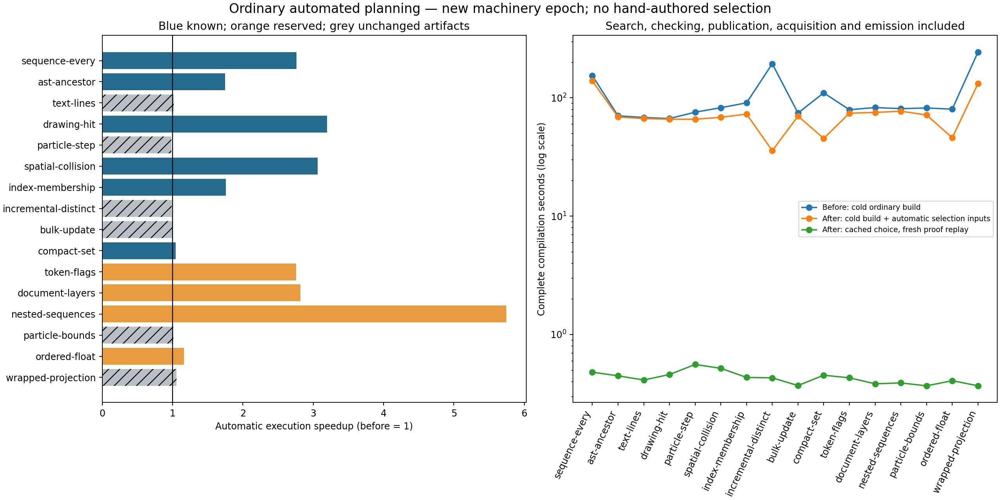

# Ordinary automatic compilation: machinery epoch E2

Ordinary balanced planning selected a proved alternative in **10/16 fixed programs**, compared with **0/16** before. No hand-written selection packet, law priority list or evaluation input was supplied. The fixed JavaScript execution cohort reports **1.697×** geometric speedup (timing-only paired 95% interval **1.679–1.716×**). The six reserved source programs report **1.953×** (**1.919–1.988×**); the ten previously known programs report **1.560×** (**1.538–1.582×**).

This is a compiler/planner improvement experiment, separate from the [frozen database-growth epoch E1](../knowledge-growth-2026-10-13/README.md). These are typed operations and partial kernels based on upstream software. They are not whole-application performance evidence. Core checking, runtime, ABI and backend semantics stayed fixed in E2; planner proof production, discovery, offline measurement, selection and knowledge-owned policy data changed. The front end forwards three new controls. The subsequent integration with newer main is a separate unmeasured integration epoch. It also expands cache/cost fingerprints to installed authored library resources, preserves current diagnostic provenance and checks corrupt-cache rejection; these integration changes are not attributed to the frozen timings.



## What changed

Semantic search now asks the installed database producers for proposals on admitted intermediate syntax. It can compose absorption, map/filter conversion and ordered early termination instead of stopping at the original source shape. A bounded support-certificate search tries alternative premises when normalization or the first support lemma fails. An incremental matcher invalidates negative lookup results when new authenticated roots arrive. Every application still proves its own conditions and every complete candidate still passes the independent checker. No new equality authority or primitive was added.

Ordinary selection generates signature- and constant-based typed probes from knowledge-owned authoring data. It measures a bounded, source-diverse shortlist of at most eight candidates with eleven interleaved rounds, complete output consumption, input immutability and independent reference comparison. Setup participates in lifecycle estimates. A comparison-adjusted paired bootstrap must support at least 5% improvement; otherwise compilation keeps the baseline. Measurements influence profitability only. No timing, hash, producer identity or database membership establishes a theorem.

JavaScript uses its trusted typed call boundary; Rust uses the existing JSON call ABI and portable snapshots in a separate adapter. These boundaries are labelled separately. Unsupported types, effectful/stateful lifecycles, migration or memory constraints decline synthetic probing. Other targets need an installed measurement adapter or supplied comparable evidence. Native adapter conformance is included; the speedup cohort here is JavaScript only. The final integrated Rust smoke retained the baseline after automatic measurement. A multi-function ordinary CLI smoke also retained the baseline because no candidate cleared the uncertainty/margin guard. These outcomes are preserved, not manually overridden.

The ordinary user command is:

```sh
ink compile program.ink --optimise /absolute/knowledge --target javascript -o program.mjs
```

Use `--target rust` for the existing native adapter. No `--plan` is supplied.
`--measurement-mode off` retains evidence-only selection; `--planning-cache off`
requests fresh planning, and `--measure-workload` supplies actual development
calls. These controls change acquisition/search policy, not proof authority.

A bounded same-epoch cache reuses a selected plan and historical cost/search diagnostics. Every hit freshly checks the full source-bound chain and target before emission. Exact source, catalogue snapshot, compiler, policy/code, host context, options and supplied workload hashes bind the key. Cache membership grants no rewrite authority. Cached history is not newly performed search or timing.

## Fixed corpus and evidence

[protocol.json](protocol.json) and [corpus.json](corpus.json) freeze sixteen programs before implementation changes. Ten are the known E1 regression cohort; six additional authored sources were reserved from tuning. [fixtures.json](fixtures.json) fixes 360 evaluation cells, including empty, small and large inputs, early/late/absent matches, alternating and adversarial cases. Selection probes use different sizes, values and distributions. Reserved results were inspected only after freezing machinery; policy was not retuned to those results.

The headline weights each program equally, then nonempty size/distribution labels equally. All 90 empty cells remain in [cases.csv](cases.csv) and the raw data. There are 149 distinct nonempty input identities among 270 nonempty labelled cells; [the descriptive sensitivity](unique-input-sensitivity.json) also averages duplicate input labels before weighting programs. This does not replace the frozen headline weighting.

Independent reference execution covers 210 bounded fixtures. Independent source-order JavaScript oracles cover large fixtures and are labelled in the tooling. Before and after outputs undergo 720 complete value/input comparisons. All output fields and floating-point bits are consumed; immutable inputs are checked before and after repeated calls. Eleven randomized interleaved rounds retain **7,920 raw timing samples**. Reduction order, wrapping arithmetic and exact float steps are preserved. The additional automatically selected fixture passed reference, C, Rust, JavaScript and both Wasm lanes for values, explicit errors and exact snapshots.

The [audit](audit.json) freshly replayed all **2,452** admitted complete candidate chains and **48** warm selected chains. It verifies frozen program/input/machinery hashes. The [candidate archive](automatic-candidates.tar.xz) includes canonical checked packets and their complete proof closures. Finite execution checks and mathematical plan replay do not prove backend correctness.

| Program | Attempts | Admitted states | Measured shortlist | Selected plan steps | Execution gain | Gain / loss nonempty cells |
| --- | ---: | ---: | ---: | ---: | ---: | ---: |
| sequence-every | 133 | 69 | 8 | 2 | 2.761× | 7 / 7 |
| ast-ancestor | 102 | 37 | 8 | 2 | 1.746× | 12 / 1 |
| text-lines | 91 | 22 | 8 | 0 | 1.017× | 0 / 0 |
| drawing-hit | 143 | 72 | 8 | 2 | 3.199× | 18 / 0 |
| particle-step | 72 | 21 | 8 | 0 | 0.981× | 0 / 0 |
| spatial-collision | 123 | 59 | 8 | 2 | 3.065× | 6 / 0 |
| index-membership | 395 | 252 | 8 | 2 | 1.759× | 7 / 5 |
| incremental-distinct | 618 | 512 | 8 | 0 | 0.989× | 0 / 0 |
| bulk-update | 68 | 21 | 8 | 0 | 0.995× | 0 / 0 |
| compact-set | 612 | 512 | 8 | 1 | 1.044× | 1 / 1 |
| token-flags | 138 | 74 | 8 | 1 | 2.757× | 15 / 0 |
| document-layers | 174 | 93 | 8 | 2 | 2.816× | 15 / 0 |
| nested-sequences | 216 | 118 | 8 | 3 | 5.744× | 14 / 0 |
| particle-bounds | 117 | 53 | 8 | 0 | 1.012× | 0 / 0 |
| ordered-float | 590 | 512 | 8 | 1 | 1.163× | 12 / 0 |
| wrapped-projection | 79 | 25 | 8 | 0 | 1.057× | 0 / 0 |

Attempts and admitted states are not reusable-family counts. Selected plan steps are not new law families; a step may contain composed applications and properties. This epoch adds no new reusable semantic family: it makes existing generic database laws discoverable and selectable automatically. The earlier cumulative-family and removal experiments stay in E1. Overlapping gains here are not added together.

## Regressions and costs

There are **14 nonempty robust regressions** and **5 empty regressions**, using the same 5% effect threshold and paired interval rule as gains. The reserved subset has **56 nonempty gain cells and no robust regressions**. Baseline-identical generated artifacts receive no transformation credit even when their timings differ significantly. [curves.json](curves.json) and [cases.csv](cases.csv) retain every loss and uncertain case.

The largest losses are long late-match, absent-match and alternating/clustered scans in `sequence-every` (roughly 0.69–0.80×); `index-find` has five smaller losses, `ast-ancestor` one small-input loss and `compact-count` one. The generated probe mixture is not the user's true distribution. Its aggregate profitability estimate cannot guarantee improvement for every regime. Supplying an actual lifecycle workload remains the route to workload-specific selection; synthetic policy must not be treated as observed usage.

Complete cold compilation median was **81.532 seconds before** and **69.465 seconds after**. These are single sixteen-program acquisition cohorts with different first-index/setup state, not a strong compile-time speedup claim. Cold time includes discovery, proof checking, publication, selection probing and emission. [cost-breakdown.json](cost-breakdown.json) retains search, reference, acquisition and artifact-emission intervals; subprocess intervals can overlap and are not an additive wall-clock decomposition. Raw receipts retain checking decisions and stop reasons. Exact standalone checker micro-cost is not separately isolated in this cohort.

Forty-eight warm compilations (three per program) had median **0.410 seconds**, including fresh full-plan replay. Cached historical diagnostic costs are explicitly separate from current work. Repeated builds on identical snapshots are the intended cache case; a changed snapshot or executable invalidates reuse.

Thirty-two independent memory processes retain sampled RSS/heap, post-GC retention and process high-water. Maximum observed whole-process high-water was **162.891 MiB**. These include harness, input/oracle and setup, and are not exact allocation totals or peak-live memory. The experiment makes no universal memory-reduction claim. This was a shared host; timing intervals quantify repeat uncertainty conditional on this corpus, not source-program sampling, contention, hardware portability or selection-distribution uncertainty.

The first runtime acquisition accidentally overlapped warm compilation. It is retained as `measurements/time-attempt1` and excluded from the headline; all timing cells were reacquired serially. [runtime-acquisition-attempt1.json](runtime-acquisition-attempt1.json) records the exclusion. The interrupted unnecessary historical-store copy is recorded separately. Development adapter/frontend failures are preserved in validation logs, not concealed as successful runs.

## Remaining limiting stages

Search is bounded by ordinary effort, candidate limits, intermediate proposal limits and proof-production limits. Recipes and physical alternatives can exhaust search without providing an executable source improvement. At most eight distinct implementations are measured; unmeasured admitted alternatives are explicitly excluded. A rejected support chain remains rejected. Proof checking was not weakened.

`text-lines`, `particle-step`, `bulk-replace`, `distinct-count`, `particle-bounds` and `wrapped-projection` kept byte-identical baseline artifacts. Their receipts distinguish discovery/shortlist/profitability exclusions. Maintained indexes, unchanged-structure reuse and broad stateful lifecycle selection remain incomplete; synthetic pure calls do not justify them. Unsupported transfer types and target adapters decline explicitly. This closes the need for manual selection in the supported demonstrated paths, not automatic optimality for all Ink software.

## Revisions and reproduction

[protocol.json](protocol.json) records exact before compiler, backend, runtime, ABI, planner and knowledge revisions. [after-machinery-freeze.json](after-machinery-freeze.json) records the after executable SHA-256 and full planner/knowledge code fingerprint. [machinery-archives.json](machinery-archives.json), before/after source hash manifests and source archives preserve the measured uncommitted file images independently of later integration. Compiler hashes differ because the front end adds flag forwarding; core/backends/runtime/ABI remain the same pinned code.

Primary upstream source and research provenance, exact upstream commits and the limits of each derived kernel remain in [E1 provenance](../knowledge-growth-2026-10-13/upstreams.json) and the per-source corpus descriptions. No new verbatim-upstream comparison is claimed for the six reserved sources.

See [benchmark reproduction](../../bench/automatic-planning/README.md). Extract `raw-evidence.tar.xz` into this report directory and `automatic-candidates.tar.xz` into its own directory before inspecting full packets and raw receipts. Use isolated databases and frozen historical source archives; do not reuse archived selection caches or benchmark results in a new acquisition. Rebuilt executables must be recorded as a new replay epoch. [Publication revisions](publication.json) distinguish the measured package commits from final merged pins.
