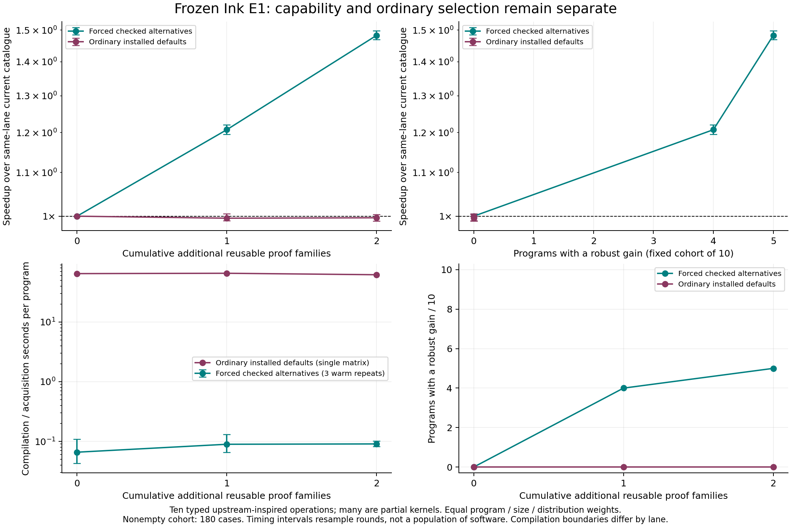
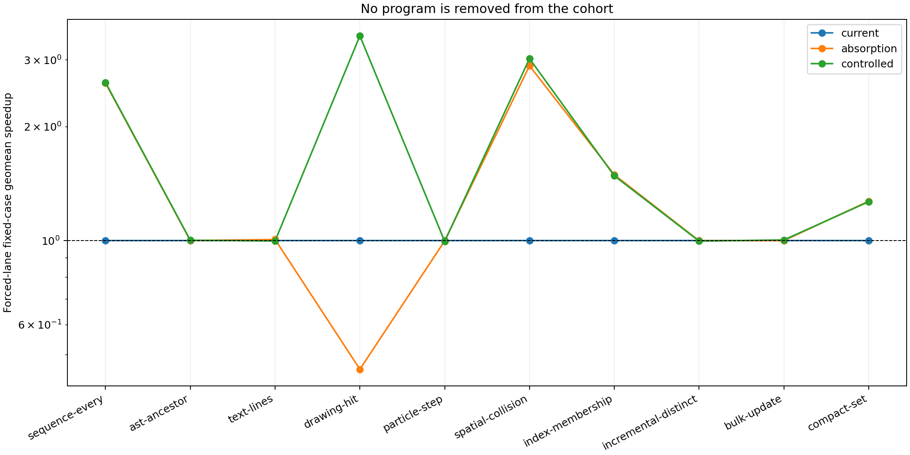
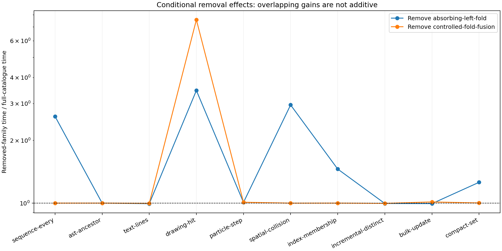

# Frozen knowledge-growth experiment, 13 October 2026

**The database supplies useful checked alternatives, but the ordinary planner did
not deliver an execution improvement in this cohort.** All 30 builds using the
installed balanced defaults selected the original program. The forced lane's
fixed, nonempty ten-program geometric mean is 1.483×
(95% timing-only interval 1.470–1.498×) over its current-catalogue baseline.
This is a capability result for typed ports, not an automatic-selection result or
a claim about arbitrary software. The actual upstream controls are retained.

The compiler, all backends, runtime, ABI, native support, planner and installed
producer/instantiator code stayed fixed in this experimental epoch. Only ordinary
library/authoring data and six templates were added. The source programs and 260
fixture files were frozen before law authoring. The runtime corpus contains 240
evaluation cells; the headline cohort keeps the same 180 nonempty cells and equal
program/size/distribution weighting at every point. Empty cases stay in the raw
results and loss tables. Twenty separate inputs were reserved for development;
none of the heldout runtime measurements guided selection or repaired a law.

The two incremental reusable proof families are absorbing Boolean **left** folds
and controlled-fold map/filter fusion. They extend established early-exit and
fusion ideas; they are not six new algorithms. Four endpoints, two support lemmas,
36 representative carrier instances and source-bound adapters are counted
separately. An exact alpha-equivalent endpoint audit found no duplicates among
537 prior canonical endpoints mentioning `foldl` or `fold_until`; this is not a
solver for arbitrary algorithm equivalence. Templates remain untrusted authoring
data. Every chosen concrete application and its entire proof closure were checked
against the actual module; there are no conditions learned from timings, hashes,
producer identity or membership.

## Performance and selection

| Lane | Checkpoint | Additional families | Selected / useful program coverage / 10 | Fixed-corpus speedup | Changed-artifact gains / losses | Complete compile median, seconds |
|---|---|---:|---:|---:|---:|---:|
| forced | current | 0 | 2 / 0 | 1.000× | 0 / 0 | 0.298 |
| forced | absorption | 1 | 6 / 4 | 1.207× | 28 / 24 | 0.408 |
| forced | controlled | 2 | 6 / 5 | 1.483× | 35 / 15 | 0.891 |
| automatic-default | current | 0 | 0 / 0 | 1.000× | 0 / 0 | 69.491 |
| automatic-default | absorption | 1 | 0 / 0 | 0.996× | 0 / 0 | 65.161 |
| automatic-default | controlled | 2 | 0 / 0 | 0.997× | 0 / 0 | 64.688 |

A robust cell requires both a paired interval excluding one and at least a 5%
change. The tables also retain every interval, lesser change and same-artifact
variation in [cases.csv](cases.csv) and [regressions.json](regressions.json).
Identical emitted bytes can still produce statistically significant timing
variation between separately loaded modules; that variation is labelled and is
not attributed to a law. Hash identity is not mathematical evidence.

The forced policy gives new families priority, then chooses structural cost,
and checks the complete chain before emission. It exercises capability and can
choose unprofitable work. It is not a production recommendation. The ordinary
lane uses the actual installed balanced defaults, with no supplied profiles or
heldout measurements. It replays the winner and retains the baseline when no
comparable lifecycle cost evidence exists. The separate short-budget `automatic`
matrix is supplemental: it has explicit 512-attempt / 16-state / eight-second
bounds and must not be described as the default configuration.

Installed defaults made 6,104 proposal
attempts and reported 4,079
additional admitted states across the matrix. These can overlap and include
properties and physical choices; they are not new algorithm families. All
3,671 distinct automatic candidate packages were exported from the
canonical publication and passed fresh logical replay. Their complete packages,
capability receipts and replay outputs are in [automatic-candidates.tar.xz](automatic-candidates.tar.xz)
and [candidate-replay.json](candidate-replay.json). Target availability is separate
from logical admission. The final selected packets have zero steps in every
ordinary-default build.

[Forced discovery](forced-compilation.json), [default receipts](automatic-default-compilation.json)
and [bounded receipts](automatic-compilation.json) retain matched proposals,
attempts, rejected edges, admitted states, budgets, exact snapshots, target
capability and final selection. Automatic attempts are counted from the stock
planner; the count is not every conceivable or latent alternative. Forced
matched-proposal counts may revisit the same endpoint.

## Attribution and adverse cases

Removing each complete family, including its support entries, keeps the same
compiler, programs, fixtures and measurement boundary. Removal effects are
conditional on the other family and on the forced sequence. In the observed
nonempty cells, 5 cells have robust contributions from
both removals and 40 from one. They are not added or
multiplied into a combined speedup. Full per-cell effects are in
[ablations.csv](ablations.csv) and [ablation-overlap.json](ablation-overlap.json).
The drawing-query composition combines a Boolean termination rule with controlled
map/filter fusion; the pre-existing AST first-result alternative is not credited
as new knowledge. Unchanged complete-output and text/distinct-trace programs stay
in the cohort.

## Costs and memory

The complete ordinary-default compilation mean is
63.92 seconds per program across the
30 builds, including discovery, checking, candidate publication/indexing and
emission. These are single runs in checkpoint/source order on a shared desktop;
cache warming and system contention confound comparisons of offline latency.
The per-process peak RSS, raw command, output and errors are retained. The
budget constrains search, not every catalogue preparation or teardown operation.
Do not interpret a later shorter compile as a causal benefit of more knowledge.

Forced compilation has three clean repeated cohorts, acquired after the bounded
matrix. Index-refresh time is recorded separately and excluded from the warm
cohort means plotted in the compilation panel. Whiskers show their observed
range, not a well-estimated population interval from three observations. Two
initial repeats overlapped compilation because an earlier failed preflight marker
existed; they remain raw but are excluded, as recorded in
[acquisition-contention.json](acquisition-contention.json). The lanes use different
discovery procedures, so their latency ratio is not a compiler acceleration claim.

The 36 carrier instances passed the frozen checker in
0.0342 seconds in one batch; that is one measurement,
not a precise checking-cost scaling law. The two cumulative publication/index
operations cost 52.49 and
3.47 seconds. The full setup/removal rebuild
cost and late OS RSS samples are in [setup-cost.json](setup-cost.json). It
reconstructs whole historical removal stores and indexes and includes old material;
it is not the cost of appending only six objects. The process termination interval
includes teardown after the final log. Late RSS samples do not establish a
whole-run memory peak. Initial upstream acquisition was not fully instrumented;
its download/setup cost remains unknown, rather than zero.

Runtime times include complete calls, output construction and bit-aware consumption
of every result field/word. Module import, fixture/oracle construction and per-lane
input adaptation are excluded and separately sampled. Inputs are checked unchanged
before/after. All selected variants match independent reference/JS oracles and the
actual upstream result wherever a control is declared. Empty, small, large,
early/late/absent-match and adversarial cases remain visible. Some domain labels
share identical inputs: [curves.json](curves.json) includes a unique-input-identity
sensitivity result, without changing the preregistered primary weighting.

Memory uses separate per-variant processes. [memory-summary.csv](memory-summary.csv)
records sampled RSS/heap, post-GC retained-heap deltas, logical JSON output bytes
and whole-process high-water RSS. It includes the harness, immutable input copies,
oracle outputs, setup and validation; it is not exact peak-live heap or total
allocated bytes. Retained deltas can be negative. Upstream index/subscription
controls are separately labelled. [runtime-contention.json](runtime-contention.json)
records active process CPU/RSS samples; no exclusive-machine claim is made.

## Source cohort and exact limits

The programs are held out of law development but are handwritten declarative
ports. Their syntax can favour a transformation. Lodash/RBush already implement
early exits; improving a fold port can recover an expert algorithm without
improving the original upstream routine. The drawing composition is authored,
not a verbatim tldraw function. These are material limits on independently chosen
software generalisation. [Research notes](research/NOTES.md) connect each primary
source to reusable algorithms and remaining source/action proof obligations.

| Program | Upstream source / role | Observation and limit |
|---|---|---|
| sequence-every | lodash/every | full typed operation |
| ast-ancestor | typescript/findAncestor | partial kernel: parent chain lookup; excludes parse/bind/AST allocation |
| text-lines | vscode/pieceTreeBase | The frozen clustered input uses code points from the pinned VS Code source, including any non-ASCII characters. The kernel counts CR/LF and preserves the final code point; it is not a piece-tree editor implementation. |
| drawing-hit | tldraw/Box | partial kernel: selected shape visibility; excludes scene/geometry/rendering |
| particle-step | verlet-js/VerletJS.frame; gl-matrix/vec2.scaleAndAdd | The frozen program updates positions of every row and preserves the active flag; it does not filter inactive rows. Its scope is a partial simultaneous Euler update, not a full Verlet simulation. The earlier manifest phrase 'for active rows' was inaccurate. |
| spatial-collision | rbush/collides | complete query result by scan; upstream control includes building its index every call |
| index-membership | CRoaring/array_contains | partial kernel: arbitrary ID membership; no sortedness or maintained index assumed |
| incremental-distinct | rxjs/distinctUntilChanged | partial kernel: complete finite value trace; excludes stream subscription/errors/scheduling |
| bulk-update | flecs/entity bulk operations | partial pure kernel: complete replacement rows, no transaction/event authority |
| compact-set | lodash/uniq | complete stable typed uniqueness; List baseline, no arbitrary JS equality |

Actual controls use Lodash 4.17.21, TypeScript 5.9.3, RBush 4.0.1, gl-matrix 3.4.4
and RxJS 7.8.2. Tarball integrity, source revisions, per-file hashes and dependency
pins are retained. The RBush control includes `new`, bulk index construction and
one query on each call; it does not rank resident indexes. The TypeScript control
uses a captured parent chain, excluding parse/bind/construction. The gl-matrix
control agrees with the source binary32 steps on the frozen exact dyadic domain,
not arbitrary F64 inputs. The RxJS control observes a synchronous finite ordered
trace through `distinctUntilChanged` and `toArray`, excluding cancellation,
reentrancy and failure semantics. Partial kernels are not whole editors, parsers,
drawing systems, simulations, dataflows or ECS applications.

| Alternative / stage | Exact limitation in this study |
|---|---|
| Absorbing Boolean left folds | Expressed, discovered, checked and lowered in forced replay; profitable only in some input regimes. Default selection retains the baseline without comparable cost evidence |
| Controlled map/filter fusion | Expressed, discovered and checked on a composed query. Mapper/predicate evaluation can duplicate work; validity does not establish profitability |
| Source helper callbacks | Chained callable results/multi-argument function-type syntax hit the fixed ordinary source elaboration boundary. `FoldInput<T,S>` records provide the same authoring data without changing compiler machinery |
| Binary search / compressed IDs | The arbitrary-ID source contract proves no sortedness, uniqueness or representation invariant. No such shortcut is admitted. This does not assert that the compiler cannot express binary search |
| Piece/finger trees and retained spatial summaries | The flat kernel interfaces have no lifetime/update contract. No source/action-bound maintained-tree candidate was supplied at these checkpoints; no expressivity impossibility claim follows |
| Differential arrangements and broader incremental views | A finite distinct-value trace provides no frontiers, retained trace/index invariant or update/query lifecycle. No arrangement candidate is present; no whole-system result is claimed |
| Bulk state / eventful operations | Returned row values have no transaction/event authority. Event ordering, errors, rollback and snapshots cannot be inferred from the pure kernel |
| Other execution targets | Helper value/error-free snapshot conformance passes C/Rust/JS/both Wasm; no GPU or non-JS execution-time extrapolation is made |

The tests preserve stopping-item semantics, wrapping words, empty results and exact
portable snapshots. The generic proof rules preserve original iteration and
binary32 grouping; they assume no associativity. The admitted pure-total
observation domain excludes resource exhaustion, allocation failures and host
traps. Those are not silently promoted into checked error-preservation claims.
No arbitrary JSON, CRDT or new host primitive was introduced. Rejected authoring
attempts and erroneous preflight CLI invocations remain archived separately.

## Frozen epoch and publication

| Package | Exact measured revision |
|---|---|
| distribution | `c30236f29d7eab18b2f1b07a8e39b50d8023eaf6` |
| core | `same repository as distribution` |
| knowledge | `972efb227bf8db706ab7de67224026dbf2ba5eff` |
| planner | `3623796f4d8df8e6212833241fa84accb9b8b8a1` |
| runtime | `449857995a2e8778f98d58fc125158fca93016d4` |
| abi | `ba66a365b4e7c2fe80fff4e7443a781f61eb9a56` |
| native-support | `a5f47e9eb44f7509cd9fa6bd64943096c453afb1` |
| lowerings/c | `cc3dd719106a17f14f3249712fa21514a5f38877` |
| lowerings/rust | `0357ca01b192261cc93453eff3f73254c31e57fe` |
| lowerings/js | `12f535564488318ba5a709dff274f2c6151e0998` |
| lowerings/wasm | `8ed92b356867d5e587289d18ba349fc7756cc872` |
| lowerings/gpu | `4b4edc75d678155b0ed923f9e7c27bbe118617c2` |

Compiler binary SHA256: `739ac85e04a41cbf8b68abc8ae5ccd00113dad35664b2867d0fc5ac6e9a392b6`.
[Execution file manifest](execution-files.json), [complete tracked-source audit](complete-machinery-audit.json), [frozen machinery archive](frozen-machinery.tar.xz), [protocol](protocol.json),
[search protocols](default-automatic-protocol.json), [corpus](corpus.json),
[fixtures](fixtures.json), [upstream provenance](upstreams.json),
[duplicate audit](duplicate-endpoint-audit.json), [helper parity](helper-validation/all-targets.log)
and [artifact audit](audit.json) bind the measured material. Hashes bind bytes;
the replayed proofs establish the admitted transformations. Historical experiments
remain unchanged and are not spliced into this fixed-cohort curve.

The ongoing compiler/discovery/physical work advances `main` separately. Any use
of that new machinery requires a new experimental epoch. Publication may include
newer package pins; that does not change which executable produced these samples.
The integration record names the final public revision separately from the
measured revision. The goal of ordinary independently chosen software acceleration
is **not established** by this limited cohort. The evidence instead identifies
working reusable capabilities, adverse regimes, a costly search/publication path,
and the missing profitability evidence at ordinary selection.

Reproduce with [the harness](../../bench/knowledge-growth/README.md). Keep exact
pins, immutable raw samples, all programs/weights and every adverse result. Do not
replace the original epoch with a newer compiler or retune on its heldout times.

Published knowledge main: `cdce64a2e0ab2a066fba37c0a2f4769668f83cfe`. [Integration record](integration.json) records newer machinery separately.
