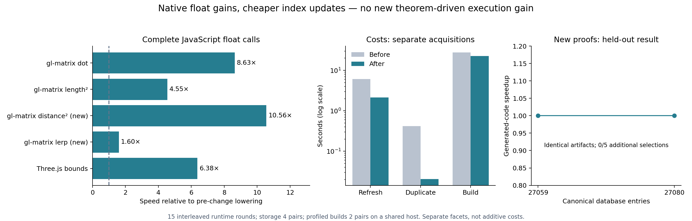

# Native JavaScript floats and cheaper database updates

Pure JavaScript float kernels now execute substantially faster without changing Ink's binary32 semantics. Modern discovery caches update without copying the entire SQLite database. A separate frozen-compiler experiment added 21 canonical objects, but produced **no additional selected execution gain** on four supported held-out kernels; a fifth unsupported kernel remains in coverage.

## Complete execution, including the boundary

| Kernel | Post-change speed relative to previous JavaScript lowering |
| --- | ---: |
| gl-matrix dot, previous corpus | 8.63× |
| gl-matrix squared length, previous corpus | 4.55× |
| Three.js bounds, previous corpus | 6.38× |
| gl-matrix vec2 squared distance, new held-out corpus | 10.56× |
| gl-matrix vec3 lerp, new held-out corpus | 1.60× |

These are geometric means of five equally weighted nonempty fixture cells per program, with 15 interleaved rounds per cell. Every result is consumed; ordinary public calls include all input and output representation work. Input construction and module loading are outside timing. No prepared internal-value call supplies these ratios. Raw samples, timing-only intervals and every cell are in [summary.json](summary.json) and the evidence archive.

Pure modules retain native Numbers and exact tagged NaN payloads. Scalar reads and arithmetic round separately to binary32. Field-only consumers borrow stable caller-owned records/lists; whole-value escape and equality retain eager invocation-local capture. Negation preserves raw payload/sign bits, structural equality compares contained bits, and scalar equality retains IEEE behavior. Worker transport preserves negative zero and exceptional Numbers. Stateful modules retain the existing bit carrier and ownership/snapshot boundaries. This is trusted backend implementation, not a database theorem or a proof of emitted machine code.

The five integer controls have **byte-identical emitted function bodies** before and after; metadata differs. Their observed timing ratios are D3 min 0.915×, D3 max 1.009×, Earcut area 1.905×, D3 extent 1.241× and Earcut equals 0.910×. These include apparent losses and large unchanged-body variation. They are retained, not counted as generated algorithm gains. Shared-host contention, JIT behavior and small kernels limit fine timing attribution. No hidden warmup was selected after reading results.

There are **192 complete fixture comparisons** against the independent Ink evaluator: 72 on the six previous programs and 120 on the four fresh supported programs, including original upstream bodies. Inputs remain unchanged. Upstream gl-matrix uses unrestricted Numbers; Ink uses ordered binary32. Equality here is restricted to bounded integer/quarter-valued fixtures, not their full APIs. The new seeds come from pinned Three.js Box3 unit-test vectors and actual Earcut source-line byte lengths. Original seeds are labelled separately from controlled repetitions and reversal. New gl-matrix distance and lerp still run at approximately 0.232× and 0.228× of the timed upstream adapters on this corpus. Improvement does not establish a library-wide win.

## Database cost

The development refresh profile identified membership insertion, whole-cache backup and migration queries as significant costs. The indexed seed is approximately 424 MB. Modern refresh now writes one SQLite transaction; failed refresh rolls back, including failure late in metadata migration. Legacy schema migration retains replacement-file publication. Missing-metadata queries use entry indexes before pinned membership checks. Newly constructed authenticated trees and one witness object per leaf are reused, and unchanged extension avoids republishing.

| Operation | Before median | After median |
| --- | ---: | ---: |
| Tree extension | 0.778 s | 1.524 s |
| Discovery index refresh | 6.062 s | 2.152 s |
| Authenticated export | 0.0099 s | 0.0051 s |
| Complete extension + refresh + export | 7.413 s | 3.789 s |
| Duplicate extension + index reuse | 0.421 s | 0.0206 s |

Four pairs use alternating order, identical initial catalogue IDs and identical resulting snapshot/view hashes. Moving the authenticated membership construction into publication increases the isolated extension phase; report the complete operation too. Individual phase medians do not sum to the median complete acquisition. Full parent-profiled quick builds, two pairs, went from a median **27.75 s to 22.61 s**. One pair regressed slightly (23.05 → 23.53 s), the other improved (32.44 → 21.69 s). This small, noisy acquisition is not a statistical general cold-build speed guarantee. Search workers and the post-change compiler are the same in both lanes; only parent storage/migration helpers differ. Profiling overhead is included.

These builds start with a discovery index and no compiled-plan cache. Constructing that index from loose canonical objects took **101.77 s** in a separately recorded acquisition. This work improves new-source compilation and knowledge updates; it does not establish a faster first-ever rebuild from an empty cache. Search, checking and reference/measurement work remain substantial.

Canonical objects, historical snapshots, membership authentication and complete proof replay remain the authority. The SQLite file remains disposable. Shared-view publication now preserves established leaf topology rather than forcing every existing catalogue back to two-entry leaves. This last change was integrated after the frozen evaluation and has separate tests, not timings attributed to the frozen epoch.

## New knowledge, with machinery frozen

Two development programs, conditional particle calculations and conditional selection, informed three reusable schemes: lift an invariant choice outside `map`, `filter` or ordered `foldr`. Eighteen concrete scalar/list instances replay through the existing equality kernel. They assume pure total callbacks; they introduce no primitive, float reassociation, target-specific recognizer or source-name whitelist. The 21 objects are genuinely new relative to the 27,059-entry base. Three schemes are proposals; admission still checks each concrete instantiation.

Five held-out source ports were registered before new-law authoring or timings: gl-matrix vec2 squared distance and length, gl-matrix vec3 lerp, D3 extent and Earcut point equality. `sqrt` prevents the original vec2 length port from compiling; that decline is retained. This is a small human-selected kernel corpus, with related libraries, not random independent applications.

The same frozen compiler, Python machinery and authoring resources compiled base (27,059 entries) and grown (27,080 entries) snapshots. All twelve ordinary quick builds disable compiled-plan cache and use automatic typed offline probes. No held-out fixture, expected output, supplied workload or forced plan enters compilation. Every build retained its baseline. The four held-out base/grown artifacts are byte-identical, so growth provides zero generated-code execution gain even when timing samples differ. Development selection admitted and measured alternatives but the profitability guard retained the baseline; the particle case reached no additional admitted state within its eight-second search budget. Neither outcome proves exhaustive absence of applicable laws.

Final publication preserves every ID in the then-current main catalogue and adds these same 21 objects with 64-entry leaves; [publication.json](publication.json) records that separate main integration (28,063 → 28,084 entries). It does not change the experimental checkpoints. All eighteen concrete laws replay again against the integrated catalogue. A subsequent composition preserves both concurrent catalogues and these additions: the final publication has 28,489 entries, recorded in `final-publication.json`; the frozen experimental checkpoints remain unchanged.

## Memory, validation and retained failures

Separate Node processes record process high-water RSS, eight-call memory observations and post-GC retention for every before/after program and every held-out checkpoint. Setup, host and output consumption affect those numbers; they are not exact per-call peaks or allocation counts. This experiment makes no general memory-reduction claim.

All 23 JavaScript package tests passed, including existing state ownership/rollback, input projection, parallel and destination suites. The new float test checks 1,903 reference cases plus destination writes, and repeats all cases through the portable binary boundary. It includes random raw binary32 patterns, signed zero, subnormals, overflow, infinities, distinct quiet/signaling NaN payloads and non-binary32 numeric inputs. Distribution JavaScript CLI integration passed both tests. Focused storage, publication, planner shared-view and template/recipe checks are retained in the validation archive. These are focused checks, not a claim that every historical repository suite passed.

A variant that tagged every potentially non-finite intermediate and made result conversion identity passed semantic checks but made bounds slower than the accepted native lane. Its source, generated artifacts and timings are retained under `rejected-normalised-carrier`. An attempted left-fold proof failed kernel normalization and was omitted; its rejection is recorded. The initial storage optimization reduced duplicate work but left expensive refresh/backup work; that first attempt's cost measurements are retained too. Losses and unsupported programs remain visible.

## Reproduction and provenance

See [tooling](../../bench/native-f32-epoch/README.md), [protocol.json](protocol.json), source manifests, checkpoints and archive manifests. The old compiler is a release binary; the new compiler is a debug binary. Runtime ratios compare their emitted JavaScript, not compiler execution. Every parent cold-build comparison uses the same new debug compiler. Compiler hashes, actual checkout revisions, all frozen planning resources and the storage helpers used for the before lane are archived. Later main integration is a separate source state. Restore the frozen resource archive before using `experiment.py`'s fingerprint check; current main is not that frozen epoch.

The result supports a concrete direction: native execution representations and cheaper catalogue bookkeeping can produce broad benefits across numerical kernels. This batch of additional proofs did not produce automatic held-out execution gains. Those are separate findings.
