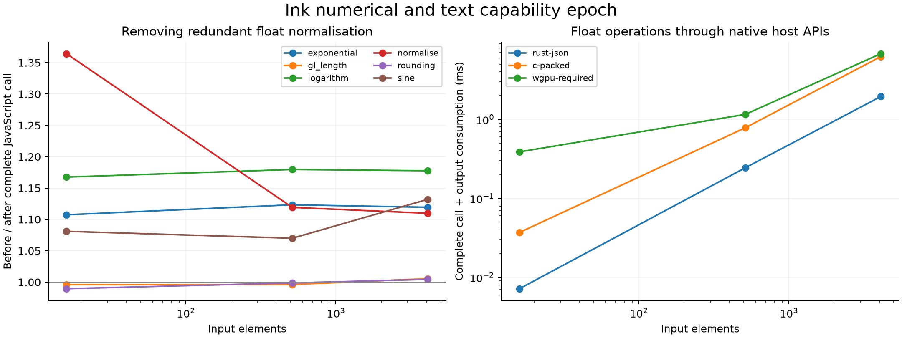

# Numerical and text capability epoch — 13 October 2026

Ink now has square root, F32 division, explicit integer/float conversions,
classification, named rounding, word counts and UTF-8 access/slicing/search.
The core owns these meanings. Derived math and chunked text algorithms live in
knowledge libraries, with 39 new checked choice-distribution laws.

[API and trust boundaries](../../docs/numeric-text-primitives.md) ·
[tooling](../../bench/numeric-text-primitives/README.md) ·
[complete data](summary.json)

## What became faster

Removing repeated JavaScript normalisation of already-computed F32 values gives
**1.093×** geometric-mean throughput across six numerical kernels and three
sizes (16, 512, 4,096 elements). Eleven interleaved rounds compare complete
public calls to saved artifacts from immediately before that change, with every
result consumed. Both artifacts produce the same reference results. Normalisation,
logarithm, exponential and sine improve; simple length/rounding and integer/text
controls are approximately unchanged. These are compiler gains, not gains from
adding database laws. This is one process on a shared host, not a population claim.

The new APIs do not establish a general upstream-library win. The gl-matrix
length port remains slower than the original body with its batching, shape adapter
and final F32 quantisation included. Other complete numerical/text calls retain
losses. Sine/exp/log host comparisons have different numerical contracts and are
cost controls, not equivalent-program speedups. All cells and the first acquisition
remain in `javascript.json` and `javascript-first-acquisition.json`.

## Native, Wasm and device measurements

`native-gpu.ndjson` measures normal generated public host calls on identical
resident JSON fixtures: generated Rust JSON→typed→JSON calls, the C packed adapter,
and required wgpu execution. Packing, execution, owned output materialisation and
consumption are charged. Nine rounds rotate the lane order. All outputs match.
At these sizes Rust's host path wins; device transfers/readback and result handling
outweigh the device work. Initial device/pipeline setup is outside steady-state
samples; the first device calls are correctness/warmup, not timed headline samples.

`wasm-javascript.json` retains both Wasm paths and JavaScript. C-Wasm includes
argument writes, packed execution, complete result materialisation and consumption.
Rust-Wasm uses resident JSON inputs, charges conversion, generated execution and
materialised output consumption inside batched exports, and excludes host wire
transport. JavaScript includes its ordinary call and required U64 input adaptation.
These boundaries differ: no aggregate backend ranking or universal deployment
recommendation follows from this table. The C-Wasm adapter initially treated a
word count as an element count; the corrected adapter checks element count × width.

The real-software kernels include pinned gl-matrix bodies, Three.js test vectors,
upstream Earcut source text and explicit bounded controls. These are kernels and
fixtures, not complete applications, nor an independently random software sample.

## What the new knowledge changed

`publication.json` records **28,490 → 28,529** entries and all 39 added law IDs.
Every law replays through the ordinary core checker (`proofs.json`). The laws
commute a pure primitive with a conditional argument; none reassociate floats,
replace division by multiplication, or substitute an approximation for an exact
expression. The algorithms in `std:math` and `std:text` are ordinary source data.

A separate authored development probe compares base/grown snapshots with the
same copied compiler and unchanged planning resources. Quick automatic planning
admits **2 → 7** states, but retains the baseline in both cases: the artifacts are
byte-identical. This batch improves applicable coverage in that program and shows
**no selected execution gain**. It is a development probe chosen around these
laws, not a held-out generalisation experiment. Complete receipts are retained.
Whole commands take about 62/41 seconds; they include bookkeeping and measurement,
not just the eight-second search budget. Index caches were already populated.

The earlier exploratory balanced run admitted 115 states and retained the baseline.
Four measured alternatives failed with `Cannot read properties of undefined
(reading 'state')`; the guard excluded them. That execution gap remains diagnosed,
not fixed by adding these primitive meanings. An initial base rerun lacked a
historical snapshot file in the private store; another was rejected by the freeze
guard when compiler/resources changed. These rejected attempts are archived and
are not used as a controlled database-growth result. The final quick probe freezes
its copied compiler and passes the planner's change guard.

Later integration adopts already-published ABI codec and JavaScript session-transport updates. The timed artifacts precede that integration; no timing gain is attributed to those concurrent changes.

The preceding frozen epoch remains intact, including its unsupported `sqrt` port:
[native F32/database update experiment](../native-f32-epoch-2026-10-13/README.md).
This capability epoch does not rewrite that result.

## Correctness and approximation scope

- 523 primitive values/outcomes and exact snapshots agree across native C, Rust,
  JavaScript and both Wasm targets; three required kernels also execute on the GPU.
- 1,134 first-order numerical comparisons per CPU target exercise the new operators.
- 152 derived math cases agree across CPU targets, including subnormals, exceptional
  floats, signed zeros, overflow-safe normalisation and out-of-domain approximations.
- The independent reference square-root test covers 50,000 raw patterns plus
  exponent/subnormal boundaries; its integer algorithm is independent of native sqrt.
- Six approximation functions meet the documented acceptance targets on 4,097
  samples each. `accuracy.json` records maximum observed errors. These are bounded
  deterministic source algorithms with tested accuracy, not unrestricted correctly
  rounded transcendentals or kernel-certified universal error bounds.
- Independent JavaScript, Rust, C, GPU, Wasm, native-support and runtime package
  suites/checks pass. The archive records the actual validation, rather than claiming
  that every historical repository suite ran.

Strings/fallible values/arbitrary Int use complete hosts when a device closure
cannot express them. Host fallback is not device coverage. No ABI type or public
patch format changed. Execution/toolchains remain trusted implementations;
conformance and timings do not prove backend correctness.
