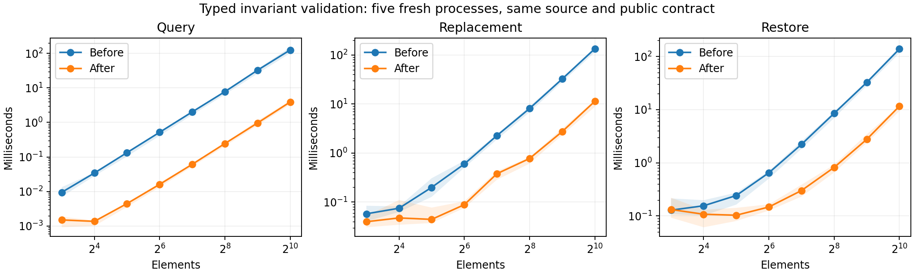

# Performance generality — retained measurements and proofs

Five fresh Node processes on a shared Apple M2 host (Node v26.1.0). Reported
costs are medians of process medians, with raw samples and process ranges retained
in `summary.json`. Alternating execution order reduces systematic order bias.
Concurrent host activity and warmed JIT behavior limit causal interpretation.

## Ordinary invariant validation

The same exact checked source, public transaction boundary and owned input/output
contract use the before/after JavaScript modules retained here. The source is
`examples/invariant-algorithms.ink`, core ID
`ea49f403ed32c9e41c724d70b3061329a0b3b8cad6d973844e5de6e4355886e3`.
The before artifact predates this pass; the after artifact uses type-directed
state equality and compiled captures. This comparison uses ordinary literal
source execution, without the invariant-backed constant query representation.

| Elements | Phase | Before | After | Ratio before/after |
|---:|---|---:|---:|---:|
| 16 | uniqueness query | 34.36 µs | 1.37 µs | 25.1× |
| 128 | uniqueness query | 2.023 ms | 61.48 µs | 32.9× |
| 1024 | uniqueness query | 125.23 ms | 3.902 ms | 32.1× |
| 1024 | replacement | 132.71 ms | 11.29 ms | 11.8× |
| 1024 | restore | 138.28 ms | 11.61 ms | 11.9× |
| 1024 | checkpoint | 543.21 µs | 608.21 µs | **0.89× (loss)** |

The predicate remains quadratic. Replacement and restore retain real ingress
and invariant validation. Snapshot equality and transient nested observations
were checked in every size/lane run. Tiny creation/checkpoint phases are noisy;
all sizes, samples and losses are retained. A proved constant query is a separate
algorithmic improvement and should not be confused with these backend gains.

## Capture mechanism

`tools/bench_state_capture.mjs` compares the unchanged previous scalar/schema
dispatcher with the compiled capture traversal. Both allocate owned values,
validate every field and consume the entire output. It is a controlled mechanism
comparison, not a complete application benchmark.

| 4096 inputs | Dispatcher | Compiled | Ratio |
|---|---:|---:|---:|
| U32 words | 370.41 µs | 249.88 µs | 1.48× |
| flat records | 3.845 ms | 1.699 ms | 2.26× |
| nested records | 9.495 ms | 7.980 ms | 1.19× |

All nine size/shape median cells improve in this exploratory run; ranges and
individual processes remain in `capture-*.json`, including noisy nested cells.
These numbers do not assert zero allocation or input validation skipping.

## Proved guards and measured selection

`guards.core.json` binds the complete checked private-list example.
`guards.request.json` and `guards.checked.json` replay 16 source-bound obligations,
including observation and future-state preservation for every action. The new
proposal simplifies `install`, `checked_install`, `is_valid` and the invariant
query. The input precondition and restore invariant check remain executable.
`publication.json` records 25 added canonical objects and the knowledge snapshot.
Database names confer no authority; the requests still require exact source and
ordinary equality checking. No action speed claim is inferred from these proofs.

`holdout/` retains fresh pure programs, selection/holdout inputs, checked plan
packets and acquisition receipts. The source names and input sizes/values differ;
the installed law is general map/take commutation. Each acquisition uses three
fresh processes. A frozen choice must clear the empirical 10% margin on training
and holdout; holdout can only reject. The actual timed winners and any rejection
are in `holdout/checks.json`. This is two fresh program/input cases, not blinded
evidence of universal workload generalisation.

Fresh rejections are excluded even if older comparable good timings exist.
Historical observations cannot make a freshly invalid candidate eligible.

## Reproduction and validation

Run `node reports/performance-generality-2026-10-13/bench-invariants.mjs OUTPUT_DIR RUN`
for each process, and `node tools/bench_state_capture.mjs OUTPUT_JSON RUN` for
captures. `summarize.py` uses matplotlib to regenerate the summaries/PNG/PDF from
retained raw samples. Artifact/sample hashes are recorded in `summary.json`.
`tools/offline_holdout_conformance.py --compiler target/debug/ink --root OUTPUT_DIR`
replays public compiler acquisition and rejects an overlapping-input control.
`ink check-representation guards.core.json guards.request.json --core` rechecks
the exact proof closure.

Focused backend tests compare capture validation/errors/limits/ownership and
raw floating-bit equality with the independent evaluator. Planner tests cover
noise tails, phase weights, insufficient samples, memory/migration, near ties,
typed holdout collisions and per-process candidate rejection. Compiled guard
conformance checks all native/JavaScript/Wasm targets plus GPU-host fallback,
invalid preconditions, correctly encoded invalid restores, and reauthenticated
conditional proofs deprived of their source domain. Full mandatory target
conformance and final main revisions are recorded in `validation.json`.

The final independent suites pass 57 core unit tests, 19 JavaScript backend
tests, 135 planner tests and 49 affected knowledge tests. An earlier planner run
sampled a killed child in a transient macOS kernel wait; the test now waits at
most one second for actual death and still rejects a live descendant. Its failed
log is retained. `planner-fixture-failure.log` retains an intermediate regression
test fixture missing workload provenance; that fixture was corrected before the
final full run. Historical failed logs are not relabelled as passing checks.

Rendering, durability amortisation, cold/setup selection, exact allocation peaks
and broad framework/Frontier comparisons are outside these timing loops.
