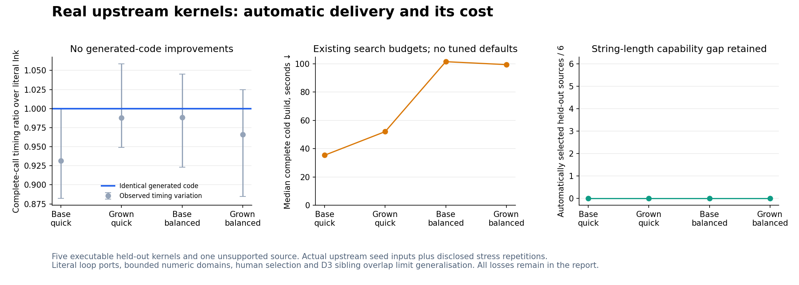
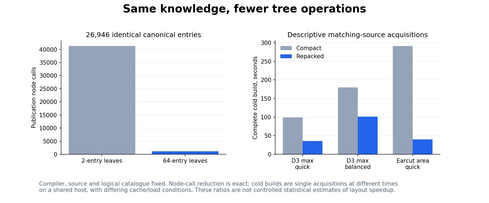

# Real upstream kernels and cold-build cost

This frozen epoch found **no generated-code improvement from 28 new database entries** on five executable held-out kernels. Every ordinary build retained the baseline, and the emitted JavaScript bytes match literal emission. Timing ratios around one are unchanged-artifact variation, including a statistically separated ratio; they are not theorem-driven gains or generated-code regressions.

Two development ports (D3 min/cumsum) informed four generic lazy-choice schemes. Six held-out sources were selected before catalogue applicability or runtime testing: D3 max, Earcut signed area, Three.js bounds, gl-matrix dot/squared length and CodeMirror text length. Five execute in the frozen compiler; CodeMirror's original UTF-16 length port fails because that snapshot does not provide the string operation. The failure stays in coverage. This is a human-selected kernel corpus, with related D3 siblings and bounded numeric domains; it is not an unbiased sample of whole applications.

All **228 complete comparisons** passed across seven executable sources, six fixtures each, literal emission, ordinary compilation and original upstream bodies. The independent Ink reference agrees too, and inputs remain unchanged. Actual seeds include an Earcut polygon, Three.js unit-test vectors and upstream source-line byte counts. Repeated 16/128/512-element and reversed inputs are controlled stress cases, separately labelled from original seeds. See [sources and tooling](../../bench/real-software-delivery/README.md).

## Execution and the upstream controls

| Held-out kernel | Ink speed relative to the upstream call |
| --- | ---: |
| D3 max | 1.50× |
| Earcut signed area | 7.82× |
| gl-matrix dot | 0.026× |
| gl-matrix squared length | 0.059× |
| Three.js bounds | 0.021× |

The equally weighted five-program, 25-nonempty-case geometric mean is **0.207×** (timing-only interval 0.188–0.234×). That is about **4.83× slower** on this fixed cohort. These are particular typed kernel calls, not library rankings. Upstream batching, shape conversion and empty-result normalisation remain inside the upstream timed call; input creation/module setup are outside all execution timings. Ink preserves wrapping words and ordered f32 operations, while upstream Numbers have different general semantics. Inputs are restricted so complete results agree exactly; this does not equate their unrestricted APIs.

The float-heavy emitted code converts every incoming float record/list to an internal bit representation and converts around each arithmetic operation. `float-boundary.json` separately measures the original emitted body with prepared internal values and isolated conversions. On the 512-pair diagnostic, its prepared kernel median is about 49 microseconds, input conversion 1.68 milliseconds and public complete call 5.42 milliseconds. These distinct entry points were sampled sequentially; their timings are not additive, not a faster public API, and not used for selection or headline ratios. They identify a substantial conversion/allocation cost that more algebraic choice laws cannot remove on their own.

Process-high-water memory and GC observations are retained for every artifact/control. They include host/module/input costs and do not measure exact per-call peaks or allocation counts. This run establishes no meaningful general memory improvement.

## Compilation and physical catalogue layout

A fresh development-only profile found that compact two-entry leaves cause approximately **41,297 node calls** when publishing this 26,946-entry catalogue. In that instrumented build, candidate publication took 251 seconds; full membership walks and republishing dominated. Cumulative phase timings overlap and instrumentation changes costs. The profile is evidence of the mechanism, not an additive wall-time decomposition.

Before reading held-out execution timings, `transport-protocol.json` registered a separate physical-layout revision using the **existing 64-entry leaf format**. The compiler, planning code, source and inputs stay fixed; every canonical entry ID stays the same. Publication now needs **1,085 node calls**, about **38× fewer**. The larger leaf enlarges individual membership witnesses; all selected packets still pass fresh complete replay.

The retained compact survey is partial. Individual matching-source quick builds went from 99 to 35 seconds for D3 max and 291 to 40 seconds for Earcut; D3 max balanced went from 180 to 102 seconds. These single acquisitions occurred at different times on a shared host, so their ratios are descriptive rather than controlled statistical estimates of layout speedup. The deterministic node reduction and development profile support the explanation. The compact run was explicitly halted between completed builds, and its full receipts remain archived.

The complete repacked evaluation has these cold-build medians across the five executable held-out sources:

| Database | Quick | Balanced |
| --- | ---: | ---: |
| Base, 26,946 entries | 35.37 s | 101.51 s |
| Grown, 26,974 entries | 52.05 s | 99.43 s |

Neither effort selected a new implementation. Increasing this search allowance supplied no measured execution benefit here. These are single cold acquisitions per source/checkpoint; differing bookkeeping, cache state and shared-machine contention limit fine attribution. The first-build cost remains substantial even with improved layout. Fifteen same-epoch cached builds took a median **0.448 seconds**, freshly replayed the complete selected proof and emitted identical bytes. Caching changes the lifecycle; it does not solve fresh builds.

## What the new knowledge establishes

Four type-parametric choice schemes and 24 concrete scalar/list laws were genuinely generated and checked. They preserve lazy values without reassociation or new primitives. All 28 objects are new relative to the base catalogue. Their validity establishes expressibility, but this corpus provides **zero additional optimisation coverage or execution improvement**. Many selected source bodies are already direct loops/maps. The next useful work should target observed costs such as float transfer/representation and accumulator storage, with separate development evidence, rather than expanding this family on the held-out results.

The generic pinned-index recency change prevents frequently reused exact snapshots from being evicted merely because publication creates other roots. Its adversarial/churn tests retain byte-identical authenticated views; it supplies no proof authority. A proposed SQL DISTINCT coverage change was slower (3.00 versus 3.95 seconds in isolated interleaved calls), was reverted and remains in the evidence.

## Limits, failures and replay

The measured compiler is the prior integrated **pre-JSON** binary `42072357…`, with exact source/resource inventories and archive bytes. It is not the newer distribution source checked out on this date. Current-main integration is recorded separately and never inherits these timings or capability conclusions. No evaluation calls, expected outputs, manual workload or forced packet entered ordinary compilation.

A first transport bootstrap copied discovery-index observation summaries without their measurement files and failed closed. The failure is retained; copied cost/root caches were removed before fresh acquisition. A later disk-full failure during atomic index refresh is also retained. Only redundant experiment-local disposable index copies were removed; sources, canonical entries, pins and results were preserved. Neither failure is silently counted as a successful cold build.

All 36 affected cache/store/template tests and the 24 concrete proof checks pass. An attempted broader 365-test suite reported one failure, 68 errors and 125 skips, predominantly missing archived research/toolchain fixtures, missing `pysat` and old source-hash expectations. Its complete failed log is retained; no full-suite pass is claimed.

Complete generated code, packets, receipts, logs, failed attempts and frozen input/reference values are stored in per-member hash-verified archives. Extract each archive into this directory before replay. `compiler-macos.tar.gz` contains the exact measured compiler; `machinery-sha256.json` binds source/resources and Git pins retain the frozen versions. Raw timing orders/samples, memory processes, topology counts, setup-repair records and every adverse result remain available.

Current-main integration rebuilt the distribution with its current backend pins,
checked all 24 published concrete laws through the kernel, and ran an ordinary
balanced `ink compile` with no supplied workload or selection packet. Its output
passed all six D3 max fixtures and input-immutability checks; the profitability
guard retained the baseline. Thirty-seven affected integration tests pass,
including the additional missing-index recency case. Exact revisions, compiler
hash, complete receipts and logs are in `integrated-validation.json` and its
verified archive. Knowledge package changes are merged in PR39; the distribution
pin/report publication is verified after merge separately.
